Muon is the optimizer behind Kimi K2 and DeepSeek V4, and it does not fit the way we shard models today. FSDP gives every GPU a slice of each weight matrix, which is fine for AdamW and wrong for Muon. FlexShard is the PyTorch library that fixes the mismatch. This post explains both: how Muon works, built from scratch, and how FlexShard runs it on hundreds of GPUs.

If you would rather watch than read, the same material is a 20-minute video. The animations in this post are taken from it, so you can skip the video and keep reading.



## The whole problem in one experiment

Take a weight matrix. Run an optimizer on all of it and look at the top four rows. Now run the same optimizer on just those four rows. With AdamW you get identical numbers. With Muon you do not.

That one difference is why FlexShard exists. The rest of the post goes in this order:

1. AdamW and FSDP, and why they fit together
2. Muon in three steps: momentum, orthogonalize, scale
3. why a slice gives Muon the wrong answer, and why the obvious fixes hurt
4. FlexShard v1 in torchtitan: move each matrix to an owner for the optimizer step
5. FlexShard v2, the standalone library: store each matrix on its owner in the first place
6. what else the same rule buys: placements, FP8, and other projects that reached it

## AdamW is elementwise

AdamW keeps two running averages for every weight: the mean of its gradient and the mean of its squared gradient. The update divides the first by the square root of the second, so every weight takes a step of roughly the same size, and then applies decoupled weight decay.

```python
w -= lr * wd * w                    # decoupled weight decay, on the old weight
m = b1 * m + (1 - b1) * g           # running mean of the gradient
v = b2 * v + (1 - b2) * g * g       # running mean of the squared gradient
w -= lr * m / (v.sqrt() + eps)      # every weight steps by about the same size
```

(Bias correction of `m` and `v` is left out; it is elementwise too.)

Each weight uses only its own gradient and its own two statistics. Nothing else. That property is called **elementwise**, and everything below depends on it.

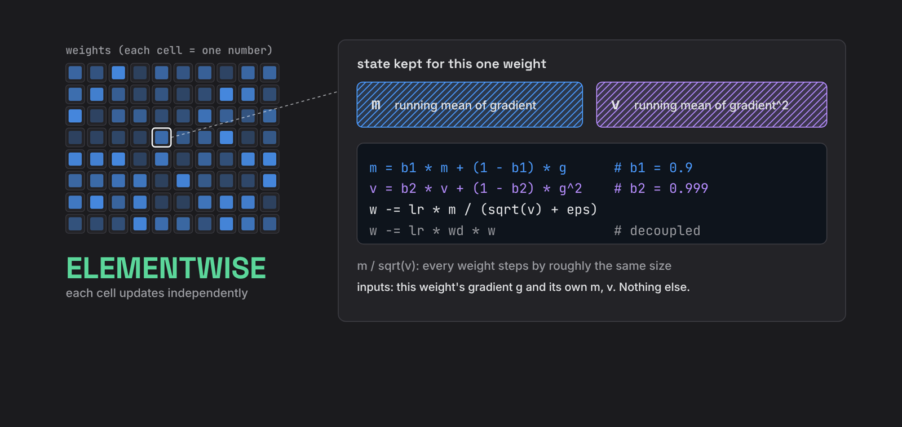

## FSDP in one training step

In plain data parallelism every GPU holds a full copy of the model and trains on its own slice of the batch. FSDP (Fully Sharded Data Parallel) keeps the data parallelism but shards those copies, so no GPU holds the whole model. With four GPUs, each one permanently stores a quarter of the rows of every weight, plus the matching quarter of its gradient and optimizer state.

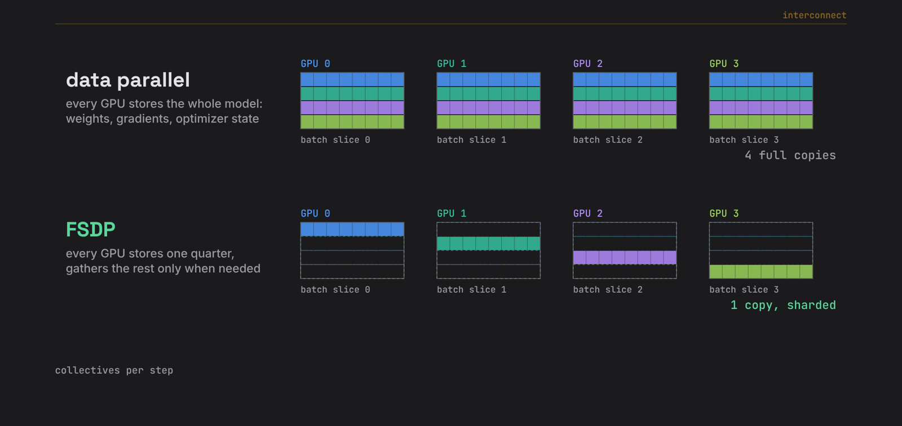

One training step:

1. **All-gather before forward.** Every GPU sends its quarter to every other, and for a moment each one holds the full weight. Forward runs, and the copies are freed.
2. **All-gather again for backward**, which produces a full-size gradient on every GPU, each from its own data.
3. **Reduce-scatter.** Each quarter of the gradient travels to the GPU that owns it and is summed on the way.
4. **Optimizer step.** Nothing moves. Each GPU runs AdamW on its own quarter.

<video controls loop muted autoplay playsinline preload="metadata" width="100%" poster="/assets/images/muon-flexshard-whole-matrices/fsdp-step-poster.png">
  <source src="/assets/images/muon-flexshard-whole-matrices/fsdp-step.webm" type="video/webm">
  <source src="/assets/images/muon-flexshard-whole-matrices/fsdp-step.mp4" type="video/mp4">
</video>

_One FSDP training step: all-gather, forward, all-gather, backward, reduce-scatter, then a local optimizer step (2x speed)._

Step 4 works because AdamW is elementwise: the slice gives exactly the same answer as the whole. That is three collectives per bucket of parameters and none in the optimizer.

## Muon: a matrix-aware optimizer

Muon breaks the elementwise assumption on purpose. AdamW treats a 2048 x 7168 weight matrix as fifteen million unrelated numbers. But a linear layer is a map, `y = W x`: every direction in the input space lands on some direction in the output space, stretched by some amount. A typical gradient update pushes a few of those directions very hard and barely moves the rest.

Muon, short for MomentUm Orthogonalized by Newton-Schulz, treats each hidden-layer weight as a matrix and makes its update push every direction equally. It has three steps.

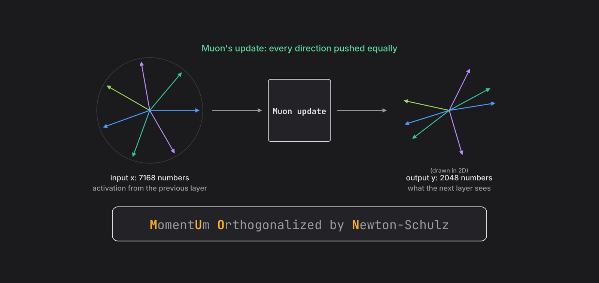

### Step 1: momentum

Like SGD with momentum, Muon keeps one running average of the gradient per weight matrix. The step it takes is that average nudged once more toward the fresh gradient (Nesterov momentum), so the newest information counts a little extra.

```python
M = 0.95 * M + 0.05 * G             # memory: running average of gradients
update = 0.95 * M + 0.05 * G        # the step: that average, nudged toward today's G
```

There is no second moment. AdamW stores two state buffers per weight, Muon stores one. So far everything is still elementwise; all the new behavior lives in step two.

### Step 2: orthogonalize

Any matrix can be written as `U S V^T`: a rotation, a stretch, and another rotation. Feed the matrix every input of length one (a circle) and the outputs form an ellipse. The long axis is the direction it pushes hardest, the short axis the one it barely pushes. The singular values in `S` are those axis lengths.

Momentum matrices are lopsided: a handful of directions dominate and many useful ones are nearly silent. Step along that matrix and you mostly push the loud directions again. Muon keeps the rotations `U` and `V` and throws away the strengths. Every singular value becomes one, and the ellipse becomes a circle. The update `U V^T` points along the same axes as the momentum but moves every direction by the same amount.

<video controls loop muted autoplay playsinline preload="metadata" width="100%" poster="/assets/images/muon-flexshard-whole-matrices/orthogonalize-poster.png">
  <source src="/assets/images/muon-flexshard-whole-matrices/orthogonalize.webm" type="video/webm">
  <source src="/assets/images/muon-flexshard-whole-matrices/orthogonalize.mp4" type="video/mp4">
</video>

_Keep the directions, drop the strengths: the ellipse becomes a circle and every singular value becomes 1 (2x speed)._

AdamW normalizes each number by its own scale. Muon normalizes each direction. In optimization terms, Muon is steepest descent under the spectral norm: the largest step that bounds how much the layer's output can change for any input, where sign descent and AdamW bound the change to each weight instead.

### Why not just compute the SVD

The columns of `V` are the eigenvectors of `M^T M`, and there is no closed formula for those on a big matrix, so libraries iterate: a chain of Householder reflections squeezes the matrix down to two diagonals, then repeated sweeps chase the remaining off-diagonal entries to zero. The arithmetic is comparable to a few large matrix multiplies, but it runs as thousands of small dependent steps, usually in 32-bit floats, which leaves a GPU's matrix units mostly idle. Muon needs this for hundreds of matrices on every training step.

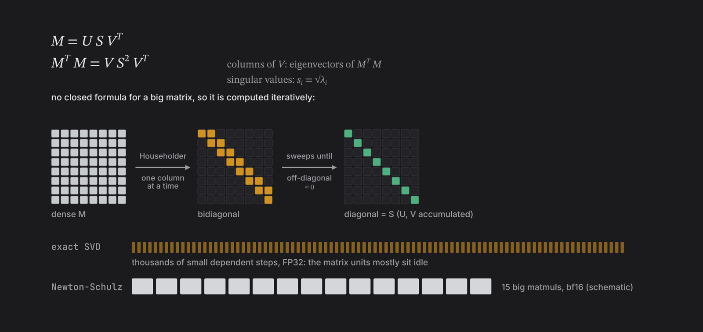

### Newton-Schulz: orthogonalize with matrix multiplies only

The trick starts with one identity. Multiply `X` by `X^T` by `X` and you get `U S^3 V^T`: the same rotations, with every strength cubed. The same holds for any odd polynomial:

```text
a X  +  b (X X^T) X  +  c (X X^T)^2 X   =   U p(S) V^T      with  p(s) = a s + b s^3 + c s^5
```

The rotations never change; each singular value `s` just becomes `p(s)`. So the whole problem shrinks to one number at a time: find a `p` that, applied a few times, sends every `s` between zero and one to about one.

<video controls loop muted autoplay playsinline preload="metadata" width="100%" poster="/assets/images/muon-flexshard-whole-matrices/newton-schulz-poster.png">
  <source src="/assets/images/muon-flexshard-whole-matrices/newton-schulz.webm" type="video/webm">
  <source src="/assets/images/muon-flexshard-whole-matrices/newton-schulz.mp4" type="video/mp4">
</video>

_Each step maps a singular value s to p(s). Tiny values more than triple per step; values near 1 stay in a band (2.5x speed)._

Muon's coefficients are `a = 3.4445, b = -4.7750, c = 2.0315`. The slope at zero is 3.44, so tiny values more than triple every step: 0.001 becomes about 0.47 in five steps. Values near one bounce around inside a band and never settle on exactly one, which is fine. The goal was never exactly one; it is that no direction gets drowned out and none blows up. The textbook polynomial `1.5 s - 0.5 s^3` does converge to exactly one, but its slope at zero is only 1.5, so the same 0.001 only reaches about 0.008 in five steps.

Here is the whole thing in numpy, with the numbers it prints:

```python
import numpy as np
a, b, c = 3.4445, -4.7750, 2.0315

def newton_schulz(M, steps=5):
    X = M / np.linalg.norm(M)              # scale so every singular value is <= 1
    for _ in range(steps):
        A = X @ X.T
        X = a * X + (b * A + c * A @ A) @ X    # three matrix multiplies per step
    return X

# a 64 x 256 matrix whose singular values span a factor of 22
rng = np.random.default_rng(0)
U, _ = np.linalg.qr(rng.standard_normal((64, 64)))
V, _ = np.linalg.qr(rng.standard_normal((256, 64)))
sv = np.geomspace(1, 1 / 22, 64)
out = np.linalg.svd(newton_schulz((U * sv) @ V.T), compute_uv=False)
print(out.min(), out.max())               # 0.68 1.13
```

Five steps squeeze a spread of 22x into a band from 0.68 to 1.13. Why five? `3.44^5` is about 480, enough to lift a normalized singular value of 0.001 to about one half, and every extra step costs three more matrix multiplies. The production kernel in torchtitan is the same loop in bf16. This is its 2-D branch; batches of matrices, such as per-head or per-expert stacks, take a second branch that does the same with `baddbmm`:

```python
def _zeropower_via_newtonschulz(update, *, ns_coefficients, ns_steps, eps):
    a, b, c = ns_coefficients
    result = update.to(dtype=torch.bfloat16, copy=True)
    transposed = result.shape[-2] > result.shape[-1]
    if transposed:
        result = result.transpose(-2, -1)                  # work on the short side
    result.div_(result.norm(dim=(-2, -1), keepdim=True).clamp_min(eps))

    for _ in range(ns_steps):
        gram = result @ result.T
        gram_update = torch.addmm(gram, gram, gram, beta=b, alpha=c)   # b*A + c*A@A
        result = torch.addmm(result, gram_update, result, beta=a)      # a*X + (...)@X
    return result.transpose(-2, -1) if transposed else result
```

### Step 3: cost and scale

"Nothing but matrix multiplies" is not the same as cheap. Each iteration is three matrix multiplies. With short side `s` and long side `l`, two of them cost about `s^2 l` and one costs `s^3`, so five iterations are `5 s^2 (2l + s)`. For one 2048 x 7168 projection that is about 340 billion multiply-adds, where AdamW's update for the same matrix is a few operations on each of its 15 million entries.

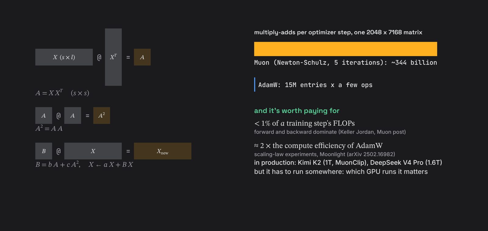

It is worth paying for. Next to the forward and backward passes it is under one percent of a training step's FLOPs, and Moonlight's scaling experiments found Muon about twice as compute-efficient as AdamW. Kimi K2, a one-trillion-parameter model, was trained with it, and DeepSeek V4 Pro uses it for most of its weights. But that compute has to run somewhere, so **which GPU runs it** now matters.

The last step is scale. An orthogonal update is tiny per entry, so the Kimi and Moonlight recipes (`adjust_lr_fn="match_rms_adamw"` in the code) multiply the learning rate by `0.2 * sqrt(max(rows, cols))`. For an exactly orthogonal update that puts the RMS at 0.2, in AdamW's range, so AdamW's learning rate and weight decay carry over. Five Newton-Schulz steps only get near orthogonal, so in practice it lands close to 0.2 (0.18 for the 64 x 256 example above). Other Muon variants scale differently.

```text
RMS(U V^T) = 1 / sqrt(max(rows, cols)) = 1 / sqrt(7168) = 0.012
lr_eff     = lr * 0.2 * sqrt(max(rows, cols)) = lr * 16.9
```

### AdamW vs Muon

| | AdamW | Muon |
|---|---|---|
| Unit of work | one number | one whole matrix |
| State buffers | 2 (m, v) | 1 (momentum) |
| Step cost | cheap, memory-bound | matmul-heavy |
| Trains | embeddings, norms, output head | hidden-layer matrices |
| Runs on a slice? | yes | **no** |

## Why a slice gives the wrong answer

Every Newton-Schulz iteration multiplies by `X X^T`, which pairs every row with every other row. So every output row depends on every input row. Orthogonalize only your slice and you get a different answer.

```python
rng = np.random.default_rng(0)
M = rng.standard_normal((8, 32))            # one weight matrix, 8 rows
whole  = newton_schulz(M)[:4]               # orthogonalize all 8 rows, look at the top 4
sliced = newton_schulz(M[:4])               # orthogonalize only the top 4 rows
print(np.abs(whole - sliced).max(), np.abs(whole).max())     # 0.177  0.498

# the same test on an elementwise (AdamW-style) update
g = rng.standard_normal((8, 32)); m = 0.1 * g; v = 0.001 * g * g
upd = lambda m, v: m / (np.sqrt(v) + 1e-8)
print(np.abs(upd(m, v)[:4] - upd(m[:4], v[:4])).max())       # 0.0
```

The error reaches 0.18 on entries no bigger than 0.50. (The clip below uses a different random matrix, where it is 0.19 on entries up to 0.46.) Muon needs whole matrices, and FSDP gives every GPU a slice of all of them.

<video controls loop muted autoplay playsinline preload="metadata" width="100%" poster="/assets/images/muon-flexshard-whole-matrices/slice-breaks-poster.png">
  <source src="/assets/images/muon-flexshard-whole-matrices/slice-breaks.webm" type="video/webm">
  <source src="/assets/images/muon-flexshard-whole-matrices/slice-breaks.mp4" type="video/mp4">
</video>

_X X^T pairs every row with every other row, so a slice orthogonalized alone comes out different (1.5x speed)._

### The obvious fixes all hurt

- **All-gather every gradient and compute everywhere.** Every GPU repeats every matrix's math and holds a full model of temporaries.
- **Gather to one GPU.** The whole optimizer step is serialized on one device while the others idle.
- **Stop sharding.** You give up FSDP's memory savings.

What we actually want is narrower: give each matrix one owner, and spread the owners evenly.

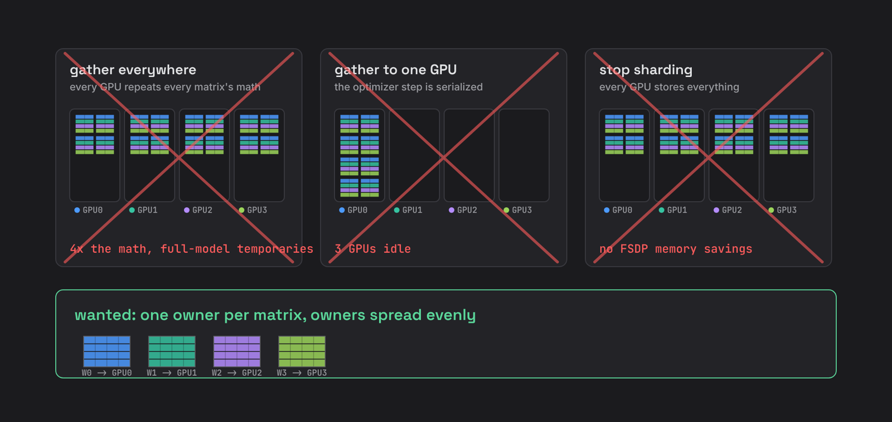

## FlexShard v1: storage layout vs compute layout

That is FlexShard's first idea, as built into torchtitan: separate the **storage layout** from the **compute layout**. Storage stays exactly as FSDP and expert parallelism laid it out, so checkpoints still see ordinary DTensors. For the optimizer step, each parameter declares a compute layout:

- `Owned()` sends the whole matrix to one GPU that FlexShard chooses.
- `BlockShard(dim, block_size)` keeps whole blocks of rows together, because Kimi-style recipes run Muon separately on each attention head.
- `Shard(0)` on a stacked-experts tensor gives each GPU whole expert matrices.

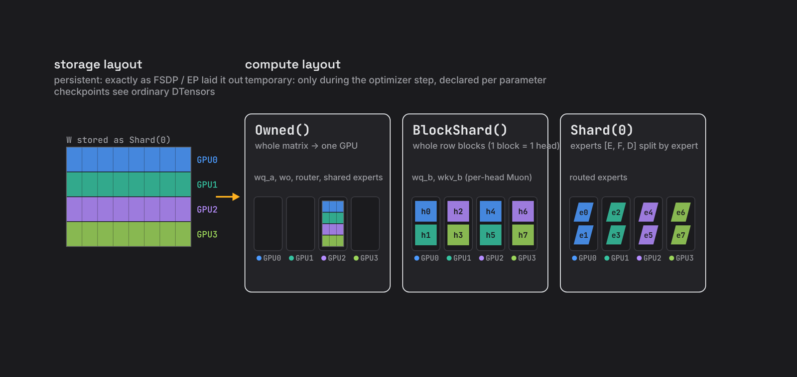

This is how torchtitan's Kimi configuration declares them:

```python
owned = ComputeLayout(
    shardings_by_mesh_axis={MeshAxisName.DP_SHARD.value: Owned()},
)
per_query_head = ComputeLayout(
    shardings_by_mesh_axis={
        MeshAxisName.DP_SHARD.value: BlockShard(
            dim=0,
            block_size=attention.qk_nope_head_dim + attention.qk_rope_head_dim,   # one head's rows
        )
    },
)
per_expert = ComputeLayout(                                            # without expert parallelism;
    shardings_by_mesh_axis={MeshAxisName.DP_SHARD.value: Shard(0)},     # with EP it shards over EP, then EFSDP
)

# parameters are grouped into buckets that move together
bucket_configs = [BucketConfig(name="layers.0-1", patterns=non_routed_fqns), ...]
```

Now one bucket of four matrices. Each GPU updates momentum locally, in its storage quarters. Then one **all-to-all**: every quarter of the first matrix flies to its owner, GPU 0; the second to GPU 1; and so on. Each owner now holds a whole matrix and runs Newton-Schulz. A second all-to-all cuts the results back into quarters and sends them home, where each GPU applies its own update.

<video controls loop muted autoplay playsinline preload="metadata" width="100%" poster="/assets/images/muon-flexshard-whole-matrices/v1-reshard-poster.png">
  <source src="/assets/images/muon-flexshard-whole-matrices/v1-reshard.webm" type="video/webm">
  <source src="/assets/images/muon-flexshard-whole-matrices/v1-reshard.mp4" type="video/mp4">
</video>

_FlexShard v1: one all-to-all sends each matrix to its owner, Newton-Schulz runs, a second all-to-all sends the results home (1.25x speed)._

The owners and routes are planned once, when the optimizer is built, and reused every step. Owners are balanced by estimated Newton-Schulz cost, and while one bucket computes, the next is already on the wire.

### The hidden cost: per-bucket barriers

The return all-to-all cannot finish until every GPU in the bucket has finished its math. So each bucket waits for its slowest owner, and the step costs the sum of those worst cases. In the FlexShard README's made-up example that is 6 + 5 + 4 = 15 units, plus 6 exchanges.

<video controls loop muted autoplay playsinline preload="metadata" width="100%" poster="/assets/images/muon-flexshard-whole-matrices/barriers-poster.png">
  <source src="/assets/images/muon-flexshard-whole-matrices/barriers.webm" type="video/webm">
  <source src="/assets/images/muon-flexshard-whole-matrices/barriers.mp4" type="video/mp4">
</video>

_Each bucket waits for its slowest owner, so the step costs the sum of the per-bucket maxima (1.5x speed)._

## FlexShard v2: store each matrix on its owner

The standalone [flex_shard](https://github.com/meta-pytorch/flex_shard) library goes one step further: decide the owner when you **store** the weight, not when you step. A `BucketedOwned` placement stores each matrix whole on its owner.

Watch the same training step again. Forward gathers each matrix from its owner, just as FSDP gathered quarters. Backward's reduce-scatter, which FSDP was doing anyway, now delivers each gradient whole to its owner. Then the optimizer step: nothing moves. No all-to-all, and no barrier.

<video controls loop muted autoplay playsinline preload="metadata" width="100%" poster="/assets/images/muon-flexshard-whole-matrices/owner-storage-poster.png">
  <source src="/assets/images/muon-flexshard-whole-matrices/owner-storage.webm" type="video/webm">
  <source src="/assets/images/muon-flexshard-whole-matrices/owner-storage.mp4" type="video/mp4">
</video>

_FlexShard v2: each matrix lives whole on its owner; forward gathers it, the reduce-scatter delivers the gradient to the owner, and the Muon step is local (1.25x speed)._

Count the collectives per bucket:

| | Forward | Backward | Optimizer | Total |
|---|---|---|---|---|
| FSDP + AdamW | all-gather | all-gather, reduce-scatter | none | 3 |
| FlexShard v1 + Muon | all-gather | all-gather, reduce-scatter | 2 all-to-alls | 5 |
| FlexShard v2 + Muon | all-gather | all-gather, reduce-scatter | none | 3 |

These are counts of communication phases in the simple case drawn here, with weights re-sharded after forward; with unevenly sized owners the library may implement a phase with several grouped transfers. Each GPU runs its own matrices, and the step costs the slowest GPU's own total (8 in the same made-up example) instead of the sum of per-bucket maxima (15).


In the library's DeepSeek V3 example, switching a bucket to owner storage is a relayout after initialization, and the optimizer then runs on local storage:

```python
placement_fn = make_bucketed_owned_full_param_placement_fn(carry_loads=True)
for storage in owner_buckets:                 # each block's non-expert bucket
    relayout_bucket(model, storage, placement_fn)

binding = build_local_dist_muon(              # DistMuon on each GPU's own storage
    model,
    [(fqn, p) for fqn, p in model.named_parameters() if fqn in matrices],
    optimizer_factory=optimizer_factory,
)
optimizer = binding.optimizer
```

Two ordering rules matter when you adopt this: the relayout replaces parameters, so it has to happen before the first forward, and optimizers are built after sharding and relayout because they hold the local shards.

### The measured result

On DeepSeek V3, 671 billion parameters on 256 H100s, the slowest GPU's optimizer step dropped from 527 ms to 301 ms: 43% shorter, without making a single matrix multiply faster. The number is from the flex_shard README, not my measurement, and it is the optimizer step timed on the GPU. The README is careful about scale: the whole training step is about 69 seconds and varies more than this between jobs, so the saving is real for the optimizer phase but is not a demonstrated end-to-end speedup. In the library's DeepSeek V3 16B example the Muon step launches no NCCL kernel at all, and on a small test model its updates match the full-tensor computation bit for bit.

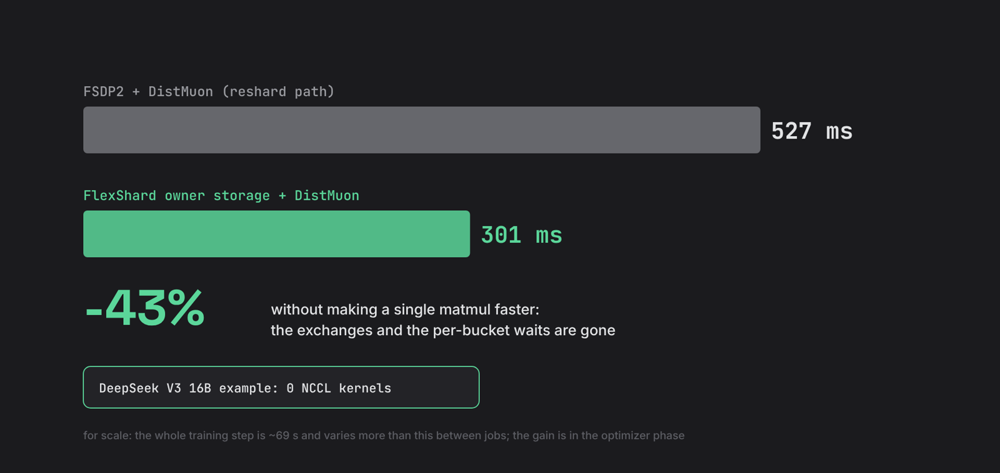

### v1 vs v2

| | v1: torchtitan DistMuon | v2: standalone flex_shard |
|---|---|---|
| Owners | planned at construction, used temporarily during each step | permanent, the storage itself |
| Between steps | FSDP quarters | each matrix whole on its owner |
| Optimizer step | 2 all-to-alls per bucket | no collective |
| Synchronization inside the optimizer step | slowest owner, every bucket | none |
| Measured (DSv3 671B, 256 H100) | 527 ms | 301 ms |

Version one is still the right tool when you want to keep FSDP2's storage untouched, and it keeps improving. In newer upstream commits than the ones quoted here, its exchange travels in bf16, half the bytes of fp32, with identical results. And with CPU offloading it runs Newton-Schulz on the GPU, which in one test cut the optimizer step from about fifteen seconds to one.

## One runtime, many placements

Version two also changes what FlexShard is. It is no longer an optimizer add-on; it is a replacement for FSDP's sharding runtime. You split the model into buckets. A bucket is one buffer per GPU, one all-gather in forward and one reduce-scatter in backward, on the same hooks, streams and prefetching that FSDP uses. What each bucket chooses is its **placement**: how its weights are stored between uses.

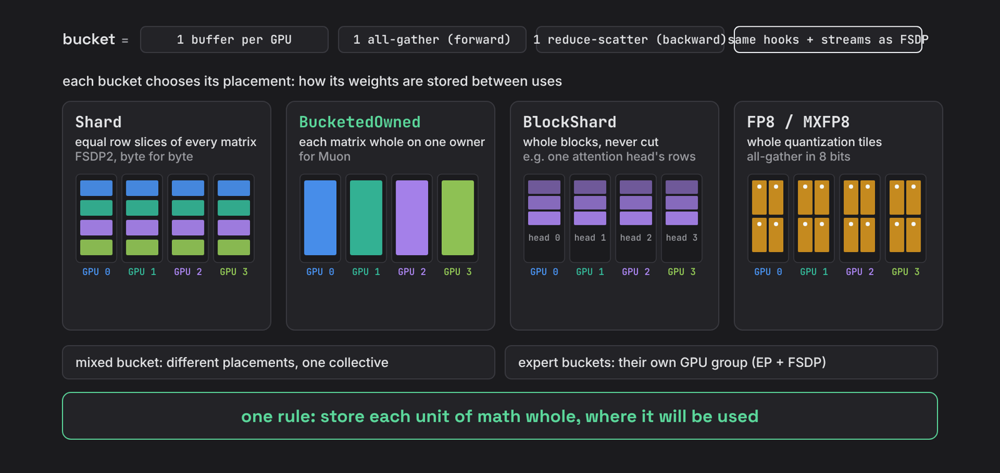

- `Shard` stores equal slices of rows, exactly like FSDP2, byte for byte.
- `BucketedOwned` stores whole matrices on owners, for Muon.
- `BlockShard` keeps whole blocks together, like the rows of one attention head. (This is a storage placement in the standalone library; v1's `BlockShard(dim, block_size)` above is a compute layout with the same idea.)
- The quantized placements keep whole quantization tiles, so they can all-gather in 8 bits.

One call replaces the per-module `fully_shard` calls. This is from the library's DeepSeek V3 example, where expert buckets run on their own group of GPUs. Note `gradient_divide_factor=1.0`: it sums gradients instead of averaging them, which is right only because this example divides the loss by the global token count.

```python
mesh = init_device_mesh("cuda", (8,), mesh_dim_names=("dp",))
expert_mesh = init_device_mesh("cuda", (2, 4), mesh_dim_names=("efsdp", "ep"))
apply_expert_parallel(model, expert_mesh["ep"])      # keep this GPU's experts

def bucket(patterns, reshard_after_forward=True, mesh=mesh):
    return BucketSpec(
        patterns,
        placement_fn=shard_placement_fn,             # Shard(1) for [2, F, D] gate/up weights, else Shard(0)
        mesh=mesh,
        mp_policy=MixedPrecisionPolicy(param_dtype=torch.bfloat16, reduce_dtype=torch.float32),
        gradient_divide_factor=1.0,                  # sum gradients: this example divides the loss by all GPUs' tokens
        reshard_after_forward=reshard_after_forward,
    )

buckets = [bucket(["tok_embeddings"])]
for i, block in enumerate(model.layers):
    names = [f"layers.{i}.{name}" for name, _ in block.named_parameters()]
    experts = [name for name in names if ".routed_experts." in name]
    buckets.append(bucket([name for name in names if name not in experts]))
    if experts:
        buckets.append(bucket(experts, mesh=expert_mesh["efsdp"]))
buckets.append(bucket(["norm", "lm_head"], reshard_after_forward=False))

flex_shard(model, buckets=buckets)
```

Checkpointing changes too: distributed checkpoints save local shards that declare their layouts, instead of DTensor state dicts.

One rule sits behind all the placements: **store each unit of math whole, where it will be used.**

## The same rule for low precision

Blockwise FP8 gives every 128 x 128 tile its own scale, and FSDP's equal slices can cut a tile in half. FlexShard's experimental FP8 placement keeps whole tiles on each GPU, quantizes locally, and all-gathers FP8: about half the bytes of bf16, and bitwise equal to gathering first and quantizing after. The saving is in the parameter all-gather only: the payload also carries one scale per tile, and the master weights and the gradient reduce-scatter stay dense. Newer upstream work adds an MXFP8 recipe with smaller 32 x 32 tiles, laid out so a single gathered copy serves both the forward and the backward matrix multiplies.

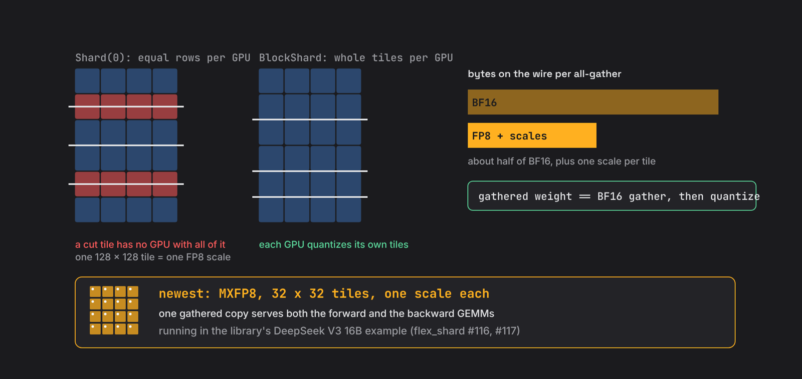

## Others reached the same rule

FlexShard is not alone. MatrixFSDP gives each whole matrix to one data-parallel rank under ZeRO-3 for the same reason, and veScale FSDP names the same two motivations, matrix optimizers and blockwise quantization. Others go around the problem: NorMuon gathers each matrix to an assigned device every step and scatters the update back, and Dion rewrites the update so no device ever needs the whole matrix.

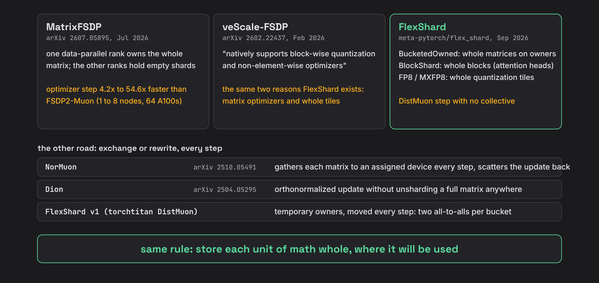

## Limits

- **Whole matrices do not split evenly**, so memory and work per GPU depend on how well owners are balanced. Version two balances owners by memory, not by Newton-Schulz cost, so some compute imbalance remains; the 301 ms already includes it.
- **The library is experimental** and uses private PyTorch APIs. It needs a CUDA build of PyTorch 2.16 or a recent nightly.
- **It targets NVIDIA GPUs today.** Each bucket needs a one-dimensional CUDA mesh, there is no CPU offload, every parameter must match exactly one bucket, and every rank must run the same graph. The planning idea itself (owners, routes, one packed exchange) is hardware-neutral.

## Recap

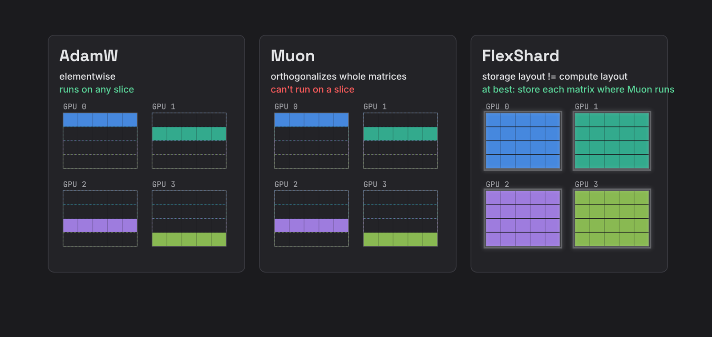

AdamW is elementwise, so it runs on any slice. Muon orthogonalizes whole matrices, so it cannot. FlexShard separates where a weight is stored from where its math runs, and at its best it stores each matrix right where Muon needs it.

- torchtitan FlexShard (v1): [torchtitan/distributed/flex_shard](https://github.com/pytorch/torchtitan/tree/main/torchtitan/distributed/flex_shard)
- Standalone library (v2): [meta-pytorch/flex_shard](https://github.com/meta-pytorch/flex_shard)
- [Muon](https://kellerjordan.github.io/posts/muon/), [Muon is scalable (Moonlight)](https://arxiv.org/abs/2502.16982), [torch.optim.Muon](https://docs.pytorch.org/docs/main/generated/torch.optim.Muon.html)
- The video: [Muon and FlexShard: why the optimizer needs whole matrices](https://youtu.be/nj4bztH4EL0)

The small-matrix numbers in this post (0.19, 0.47, 0.68 to 1.13) come from running the numpy snippets above. The code excerpts are from torchtitan at `2ad96c939` and flex_shard at `97d7647`.

<!-- The front-matter image is kept for the home-page card and link previews; hide it on the post page, where the video sits at the top. -->
<style>
  article header .preview-img, article header .preview-img + figcaption { display: none; }
</style>
