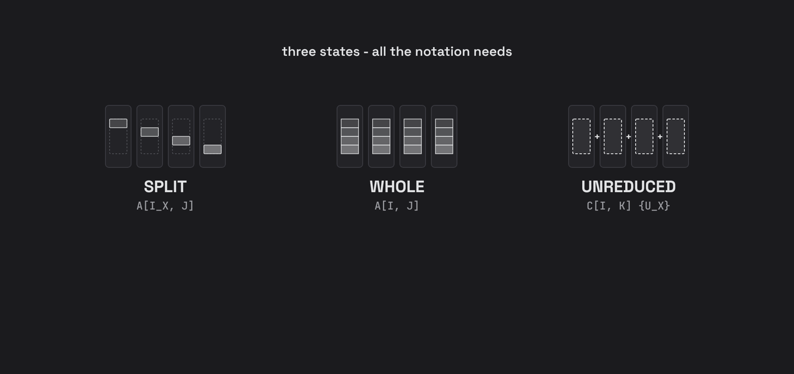
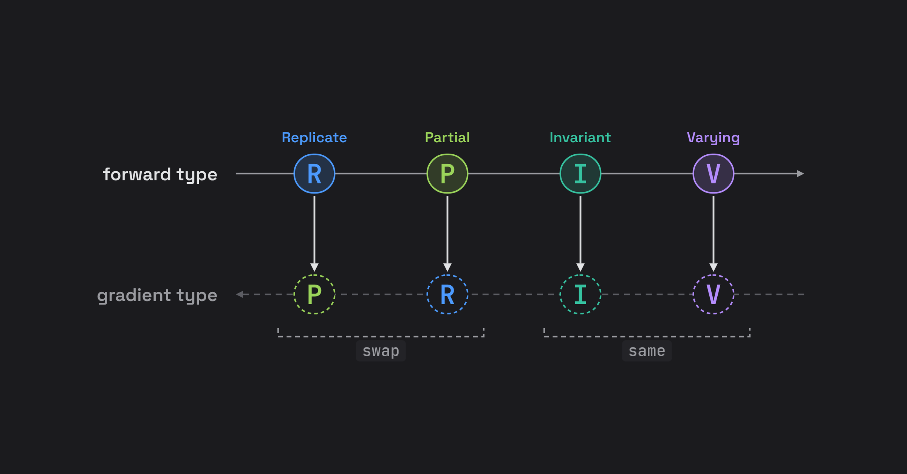
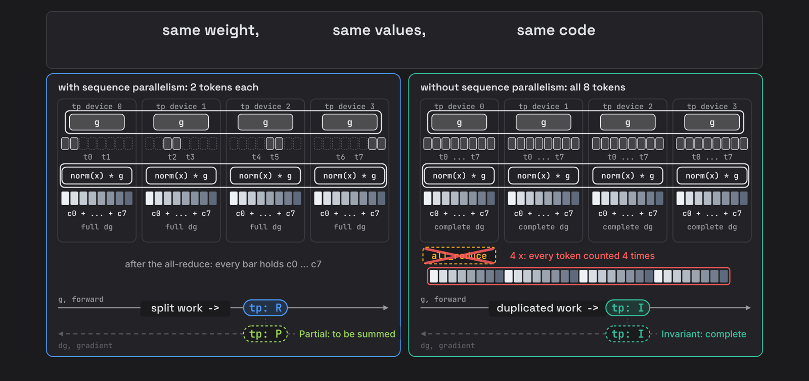
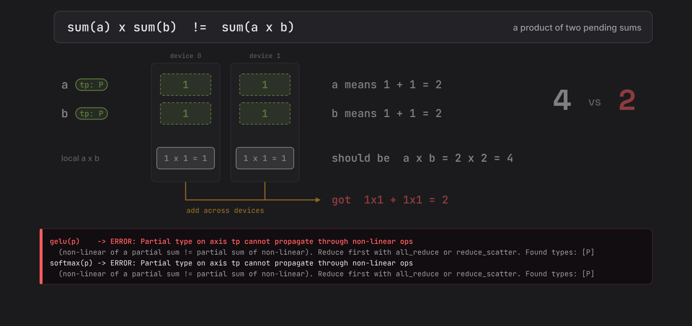
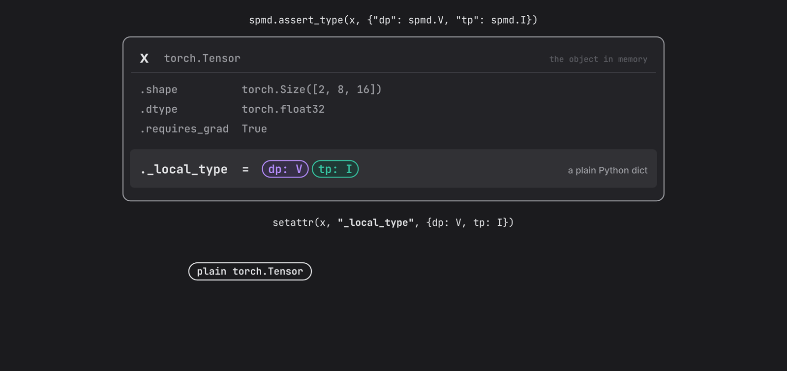
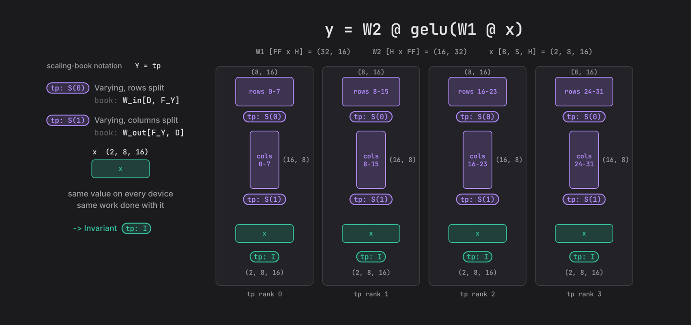
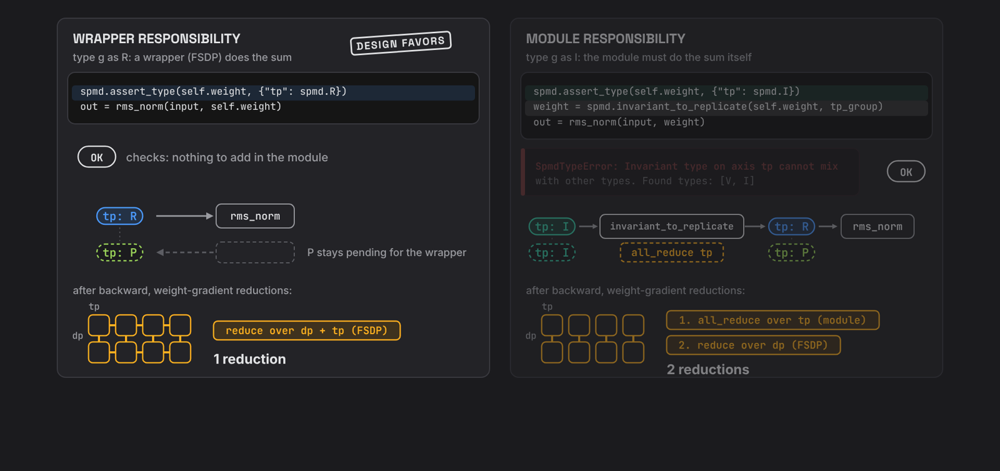
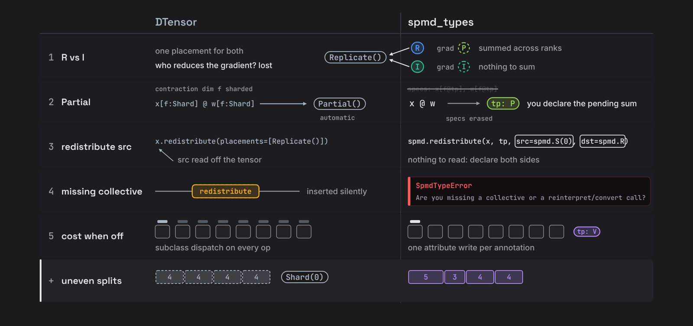
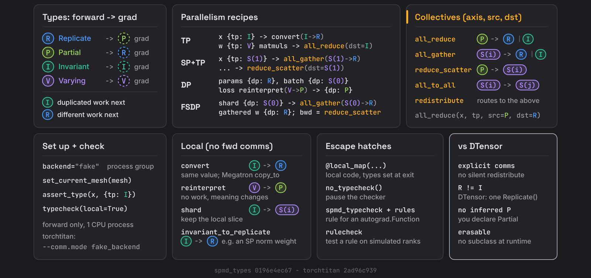

I thought I had a pretty good understanding of how collectives work when you shard a model. Then I sat down with [spmd_types](https://github.com/meta-pytorch/spmd_types), and it still took me a while to really get it. This post is what I worked out, written down as a reference.

If you would rather watch than read, the same material is a 31-minute video. The animations in this post are taken from it, so you can skip the video and keep reading.



## What spmd_types is

spmd_types is a type system for distributed PyTorch, from the [meta-pytorch](https://github.com/meta-pytorch/spmd_types) organization. It is built on two ideas:

1. **Explicit collectives.** Every all-gather, all-reduce and reduce-scatter is a line in your code. Nothing communicates behind your back.
2. **Checked shardings.** Every tensor carries a small type per mesh axis, and a checker verifies that the collectives you wrote are the ones those types require, in the forward pass and, by construction, in the backward pass.

The check is one forward pass in a single process on a fake process group, which stubs out the communication. The kernels still run for real, so a model that runs on CPU (or on fake tensors) can be checked on a laptop or in CI. With the checker off, the types are plain attributes on ordinary tensors: there is no subclass and no per-operation overhead.

The rest of the post builds this up in order:

1. the device mesh, the sharding notation from the scaling book, and collectives as data movement
2. the four types: Varying, Replicate, Invariant and Partial
3. how annotation works and what the checker does
4. tensor parallelism, sequence parallelism, data parallelism and FSDP, typed step by step
5. escape hatches, a comparison with DTensor, and the current limits

## The device mesh

Picture eight devices as a 2 x 4 grid, a device mesh with two named axes: `dp` of size 2 and `tp` of size 4. An axis is a direction you communicate along. A collective on `tp` involves the four devices of one row; a collective on `dp` involves the two devices of one column. Each row and each column is a group that only talks among itself.

<video controls loop muted autoplay playsinline preload="metadata" width="100%" poster="/assets/images/spmd-types-explicit-collectives-checked-shardings/mesh-axes-poster.png">
  <source src="/assets/images/spmd-types-explicit-collectives-checked-shardings/mesh-axes.webm" type="video/webm">
  <source src="/assets/images/spmd-types-explicit-collectives-checked-shardings/mesh-axes.mp4" type="video/mp4">
</video>

_A collective on tp stays inside one row; a collective on dp stays inside one column._

Everything below is stated per axis. A tensor can be split along `dp` and identical along `tp` at the same time, and the two facts are tracked independently.

## Sharding notation from the scaling book

If you have read [How to Scale Your Model](https://jax-ml.github.io/scaling-book/sharding/), you already have most of the vocabulary. Its sharding chapter describes a distributed array with three states, here for one mesh axis X:

- `A[I_X, J]`: dimension I is **split** across X. Each device holds one slice, different data on every device.
- `A[I, J]`: no subscript, nothing is split. Every device holds the **whole** array.
- `C[I, K] {U_X}`: **unreduced** along X. Every device holds a full-size array, but each one is only a partial sum; the real value is the sum over the axis.



Collectives move data between those states, and the clearest place to see them is a sharded matrix multiply `A[I, J] * B[J, K] -> C[I, K]`, which sums over J.

**No contracting dimension is split.** If A is split along I and B is whole, each device multiplies its rows of A by all of B and gets its rows of C. No communication.

**One side is split on the contracting dimension.** If A is split along J and B is whole, no device can finish alone. You all-gather A first: every device sends its slice to every other device until each holds all of A.

<video controls loop muted autoplay playsinline preload="metadata" width="100%" poster="/assets/images/spmd-types-explicit-collectives-checked-shardings/allgather-poster.png">
  <source src="/assets/images/spmd-types-explicit-collectives-checked-shardings/allgather.webm" type="video/webm">
  <source src="/assets/images/spmd-types-explicit-collectives-checked-shardings/allgather.mp4" type="video/mp4">
</video>

_AllGather: split to whole._

**Both sides are split on the contracting dimension.** Each device holds a slice of A along J and the matching slice of B, multiplies them locally, and gets a full-size result that is only part of the sum: `C[I, K] {U_X}`. There are two ways to finish. An all-reduce adds the partial results and leaves the complete C on every device:

<video controls loop muted autoplay playsinline preload="metadata" width="100%" poster="/assets/images/spmd-types-explicit-collectives-checked-shardings/allreduce-poster.png">
  <source src="/assets/images/spmd-types-explicit-collectives-checked-shardings/allreduce.webm" type="video/webm">
  <source src="/assets/images/spmd-types-explicit-collectives-checked-shardings/allreduce.mp4" type="video/mp4">
</video>

_AllReduce: unreduced to whole._

A reduce-scatter adds them too, but each device keeps only one slice of the sum:

<video controls loop muted autoplay playsinline preload="metadata" width="100%" poster="/assets/images/spmd-types-explicit-collectives-checked-shardings/reducescatter-poster.png">
  <source src="/assets/images/spmd-types-explicit-collectives-checked-shardings/reducescatter.webm" type="video/webm">
  <source src="/assets/images/spmd-types-explicit-collectives-checked-shardings/reducescatter.mp4" type="video/mp4">
</video>

_ReduceScatter: unreduced to split._

Two facts are worth keeping in mind. An all-reduce is exactly a reduce-scatter followed by an all-gather, so a reduce-scatter moves half the data. And in the backward pass they trade places: the backward of an all-gather (into a Replicate result, see below) is a reduce-scatter, and the backward of a reduce-scatter is an all-gather.

## The four types

spmd_types states the same things per mesh axis, as a type on each tensor. A type answers one question for one axis: across the devices on this axis, how do the copies of this tensor relate?

| Type | The devices hold | Scaling book | Gradient type |
|---|---|---|---|
| **V** Varying | different values | `A[I_X, J]` | V |
| **P** Partial | terms of a sum not yet added | `{U_X}` | R |
| **R** Replicate | identical values | no subscript | P |
| **I** Invariant | identical values | no subscript | I |

A tensor has one entry per axis. A batch of inputs that is split by example across `dp` and identical across `tp` is `{dp: V, tp: I}`.

The last column is the design: Replicate and Partial swap, Invariant and Varying stay. The type of a gradient is decided by the type of the forward value and nothing else, so by checking the forward pass you know what every backward collective must be.



Notice that the book's "no subscript" maps to two types. That is the part that needs explaining, and it comes after Varying.

### Varying

Varying means the devices hold different values. The everyday case is a shard: split a weight into four slices, give one to each `tp` device, and that weight is Varying on `tp`.

When you know which dimension was split you can write `S(i)`, shard on dimension `i`. `S(i)` is still Varying; it also records how to stitch the pieces back, by concatenating along dimension `i`. Plain `V` makes no such promise, which is what you want for uneven pieces or pieces with no global meaning.

<video controls loop muted autoplay playsinline preload="metadata" width="100%" poster="/assets/images/spmd-types-explicit-collectives-checked-shardings/shard-concat-poster.png">
  <source src="/assets/images/spmd-types-explicit-collectives-checked-shardings/shard-concat.webm" type="video/webm">
  <source src="/assets/images/spmd-types-explicit-collectives-checked-shardings/shard-concat.mp4" type="video/mp4">
</video>

_S(i) is Varying plus the rule for putting the pieces back together._

The gradient of Varying is Varying. Each device's slice gets the gradient for that slice, and nothing moves.

### Replicate and Invariant

R and I hold identical bytes on every device. The difference is what the devices do with the tensor: do they **split** the work that uses it, or does each device **duplicate** all of it?

Take an RMSNorm weight `g` and a sequence of 8 tokens on 4 tensor-parallel devices. On one GPU the gradient of `g` is a sum with one contribution per token:

```text
dg = c0 + c1 + c2 + c3 + c4 + c5 + c6 + c7
```

With sequence parallelism each device normalizes its own 2 tokens. Device 0 computes `c0 + c1`, device 1 computes `c2 + c3`, and so on. Each device holds a quarter of the sum, and the pieces must be added up. Split work: `g` is **Replicate**, and its gradient is Partial.

<video controls loop muted autoplay playsinline preload="metadata" width="100%" poster="/assets/images/spmd-types-explicit-collectives-checked-shardings/rvi-allreduce-poster.png">
  <source src="/assets/images/spmd-types-explicit-collectives-checked-shardings/rvi-allreduce.webm" type="video/webm">
  <source src="/assets/images/spmd-types-explicit-collectives-checked-shardings/rvi-allreduce.mp4" type="video/mp4">
</video>

_Replicate: each device holds 2 of the 8 contributions; an all-reduce assembles the full gradient._

Without sequence parallelism every device normalizes all 8 tokens, so every device computes the whole sum. Each one already has the complete gradient, and adding them up would count every token four times. Duplicated work: `g` is **Invariant**, and its gradient is Invariant.



| | Replicate | Invariant |
|---|---|---|
| Values on the devices | identical | identical |
| Work that uses the tensor | split, a different slice per device | duplicated, every device does all of it |
| Local gradient | a piece of the true gradient | already the true gradient |
| Backward must | sum over the axis | do nothing |
| Gradient type | P | I |

Mislabelling costs you in both directions. R labelled as I skips the sum and leaves gradients partial. I labelled as R sums gradients that were already complete, so on 4 devices they come out 4x too large.

You meet both in every model:

- **Data-parallel weights are R on `dp`.** Every group holds the same weights and applies them to different examples, so DDP or FSDP sums the gradients.
- **Norm weights are I on `tp` without sequence parallelism and R with it.** torchtitan encodes that in one line: `dense_param_placement(tp=spmd.R if enable_sp else spmd.I)`.
- **An activation can switch.** Between tensor-parallel blocks the hidden state is I. When it enters a column-parallel linear, each device multiplies it by a different weight shard, so it has to become R. That switch is `spmd.convert(x, tp, src=spmd.I, dst=spmd.R)`: nothing happens in the forward, and the backward all-reduces the gradient pieces.

You cannot pick freely, because the checker enforces one rule: among tensors that can receive a gradient, Invariant may only meet Invariant. (An operand that cannot receive a gradient, such as a buffer or anything under `torch.no_grad()`, is exempt: R and I are indistinguishable for it, so it takes whichever the other operands need.) These are real checker results, with `requires_grad=True` everywhere:

```text
linear(batch {dp:V}, w {dp:R})       ->  {dp: V}
linear(batch {dp:V}, w {dp:I})       ->  Invariant type on axis dp cannot mix with other types. Found types: [V, I]
rms_norm(x_seq {tp:V}, g {tp:R})     ->  {tp: V}
rms_norm(x {tp:I}, g {tp:R})         ->  Invariant type on axis tp cannot mix with other types. Found types: [I, R]
```

The rule follows from the definition. I says "everything here is a duplicate". As soon as an I tensor touches something that differs per device, the work is no longer duplicated, and you have to say so with an explicit I to R conversion, which is exactly where the backward sum lives.

### Partial

Partial means each device holds one term of a sum that has not been added up. It comes from a matrix multiply over a split dimension (the unreduced case above), or from a local loss: each data-parallel group computes the loss on its own examples, the global loss is their sum, so the local loss is Partial on `dp`.

Partial is useful because you can wait. A pending sum survives linear operations, since `sum(a) + sum(b) = sum(a + b)`, and the sum you eventually perform may be a cheaper reduce-scatter. It does not survive anything nonlinear:



The checker agrees (real results on a Partial tensor `p` and a Replicate tensor `r`):

```text
p + p        ->  {tp: P}
2 * p        ->  {tp: P}
p * r        ->  {tp: P}
gelu(p)      ->  Partial type on axis tp cannot propagate through non-linear ops
                 (non-linear of a partial sum != partial sum of non-linear).
                 Reduce first with all_reduce or reduce_scatter. Found types: [P]
```

The gradient of Partial is Replicate: the gradient of a sum flows back unchanged to every term.

### Two design choices

The gradient table is the first design choice: the backward type is a function of the forward type alone, so no non-local reasoning is ever needed.

The second is which "whole" type is the default. JAX's sharding types give a replicated forward a replicated gradient, and use a separate type, `reduced`, when you want a pending-sum gradient. spmd_types goes the other way: R, replicate forwards and partial backwards, is the normal case, and I is the opt-in. A pending sum keeps options open, so the practical advice is to prefer R in forward code and keep I mostly for parameters.

## How annotation works

First, name your axes. `spmd.set_current_mesh(mesh)` takes the mesh so that the strings `"dp"` and `"tp"` mean something.

Use the **compute mesh**, the axes your activations are split along, not the mesh FSDP stores weights on. With hybrid FSDP, context parallelism and tensor parallelism the two differ. FSDP's storage mesh has `dp_replicate`, `dp_shard`, `cp` and `tp`, and it shards weights over `dp_shard x cp`. The compute mesh folds the two data axes into one, `dp = dp_replicate x dp_shard`, next to `cp` and `tp`. Types are always written against the compute mesh.

Then annotate with `spmd.assert_type`:

```python
mesh = init_device_mesh("cuda", (2, 4), mesh_dim_names=("dp", "tp"))

with spmd.set_current_mesh(mesh):
    spmd.assert_type(x, {"dp": spmd.V, "tp": spmd.I})        # an input batch
    spmd.assert_type(w1, {"dp": spmd.R, "tp": spmd.S(0)})    # a weight shard, split on dim 0 along tp
```

That call writes the dictionary onto the tensor as an ordinary Python attribute, `x._local_type`. The tensor stays a plain `torch.Tensor`. There is no subclass, no copy and no communication.



If the tensor already has a type, the same call checks it instead of overwriting it, and raises if the two disagree. Two refinements are allowed: `V` then `S(i)` adds the split dimension, and `V` then `P` relabels different-per-device values as a pending sum.

```python
spmd.assert_type(x, {"tp": spmd.I})    # ok: consistent with what x already carries
spmd.assert_type(x, {"tp": spmd.R})    # SpmdTypeError: SPMD type mismatch on axis tp: tensor has I, expected R

spmd.get_local_type(x)                  # {dp: V, tp: I}
type(x) is torch.Tensor                 # True
```

Writing `S(i)` instead of `V` stores one more fact, the split dimension.

You annotate every input and every parameter. That is enough for the checker to work out everything in between. Asserting types at module boundaries is optional, and works like a function signature: it documents the contract and fails at the line that breaks it.

```python
class MLPBlock(nn.Module):
    def forward(self, x):
        spmd.assert_type(x, {"tp": spmd.S(1)})      # what this module expects
        out = self.down(F.gelu(self.up(self.norm(x))))
        spmd.assert_type(out, {"tp": spmd.S(1)})    # what it promises to return
        return x + out
```

## What the checker does

The checker is a context manager, `spmd_types.checker.typecheck()`. Under the hood it is a `TorchFunctionMode`: every torch operation runs normally, then the checker reads the types of its inputs, applies the rule for that operation and stamps the result type on the output.

<video controls loop muted autoplay playsinline preload="metadata" width="100%" poster="/assets/images/spmd-types-explicit-collectives-checked-shardings/checker-poster.png">
  <source src="/assets/images/spmd-types-explicit-collectives-checked-shardings/checker.webm" type="video/webm">
  <source src="/assets/images/spmd-types-explicit-collectives-checked-shardings/checker.mp4" type="video/mp4">
</video>

_One op under the checker: run, read the input types, apply the rule, stamp the output._

There are two levels of checking. `typecheck(local=True)` tracks R, I, V and P, which is what proves the gradients right, and is the mode for porting existing Megatron-style code. In this mode an `S(i)` annotation is recorded but not propagated through operations, so it documents a layout without proving it. `typecheck(local=False)` adds global checking: every Varying axis needs a `PartitionSpec`, and the checker propagates which tensor dimension is split through each operation, so a program is guaranteed to mean the same thing on one device or many. The library's advice is local checking inside modules and global annotations at module boundaries. The README describes the global mode as still under construction.

The checker is strict by default: an operation that mixes annotated and unannotated tensors is an error. `typecheck(strict_mode="permissive")` allows the mix, which is how you annotate a codebase incrementally.

The rules for ordinary operations are short, because ordinary operations never communicate:

```text
op(R, R)                 ->  R
op(R, V)                 ->  V
linear op on P           ->  P
op(I, anything not I)    ->  error
nonlinear op on P        ->  error
```

Collectives are different. They take a real process group plus a source type and a destination type. The checker verifies the input really has the source type and stamps the destination type on the output. The pair also selects the backward:

| Call | Forward | Backward |
|---|---|---|
| `spmd.all_gather(x, tp, src=S(i), dst=R)` | all-gather | reduce-scatter |
| `spmd.all_gather(x, tp, src=S(i), dst=I)` | all-gather | nothing (each device keeps its slice) |
| `spmd.reduce_scatter(x, tp, dst=S(i))` | reduce-scatter | all-gather |
| `spmd.all_reduce(x, tp, dst=R)` | all-reduce | all-reduce |
| `spmd.all_reduce(x, tp, dst=I)` | all-reduce | nothing |
| `spmd.all_to_all(x, tp, src=V, dst=V)` | all-to-all | all-to-all |
| `spmd.convert(x, tp, src=I, dst=R)` | nothing | all-reduce |

A few defaults are worth knowing. Everything after the process group is keyword-only. The reductions default to `src=P`, and also accept `src=V`, which treats different-per-device values as a pending sum. With `S(i)` a gather concatenates and a scatter splits along dimension `i`; with plain `V` they stack and unbind along a new leading dimension. And `spmd.redistribute(x, tp, src=..., dst=...)` picks the collective for you from the two types (`S(i) -> R` is an all-gather, `P -> S(i)` a reduce-scatter, `S(i) -> S(j)` an all-to-all) while preserving the tensor's meaning.

Megatron has a separate autograd function for each forward/backward combination (`copy_to_tensor_model_parallel_region`, `reduce_from_tensor_model_parallel_region`, the sequence-parallel gather and scatter, and so on). Here there is one function per collective, and `src`/`dst` pick the variant. `copy_to` is the last row.

Two more operations change a type without communicating in the forward. `convert` keeps the meaning and may do local work; `reinterpret` touches nothing, so the meaning can change. Four copies of `3` typed R mean 3; reinterpreted as P they mean 12, which is rarely intended, so that direction is gated behind `expert_mode=True`. The common use is the safe direction, declaring a Varying result to be a pending sum: `spmd.reinterpret(y, tp, src=spmd.V, dst=spmd.P)`. `spmd.shard(w, tp, src=spmd.I, dst=spmd.S(0))` is a local slice, which is how parameters get their shards without communication.

One more argument matters in practice. When a collective runs in reduced precision and its backward is a reduction, you must say which precision the gradient reduction uses, and the library raises if you do not:

```python
# bf16 activations: the forward all-gather moves bf16, the backward reduce-scatter sums in fp32
a = spmd.all_gather(x_bf16, tp, src=spmd.S(1), dst=spmd.R,
                    backward_options={"op_dtype": torch.float32})
```

A complete check looks like this:

```python
import torch.distributed as dist
import spmd_types as spmd
from spmd_types.checker import typecheck
from torch.distributed.device_mesh import init_device_mesh

dist.init_process_group(backend="fake", rank=0, world_size=8)   # one process pretends to be rank 0 of 8
mesh = init_device_mesh("cpu", (2, 4), mesh_dim_names=("dp", "tp"))

with spmd.set_current_mesh(mesh), typecheck(local=True):
    loss = model(batch)      # forward only
```

An error is raised at the operation that broke a rule, and names the axis, the types it found and the collective you probably meant:

```text
SpmdTypeError: Invariant type on axis tp cannot mix with other types. Found types: [I, V]
Are you missing a collective or a reinterpret/convert call? e.g.,
  convert(tensor, tp, src=I, dst=R) on the Invariant operand (no-op forward, all-reduce in backward)
  In linear(
    args[0]: f32[4, 16] {dp: V, tp: I},
    args[1]: f32[8, 16] {dp: R, tp: V},
  ) under mesh {dp, tp}
```

## Tensor parallelism

One MLP, `y = W2 gelu(W1 x)`, on 4 `tp` devices.

**Shardings.** W1 is split by its output rows, so each device holds a quarter of the hidden units: `S(0)` on `tp`. W2 is split the matching way, by its input columns: `S(1)`. The input `x` is the same on every device, and so far every device has done the same work with it, so it is I. In scaling-book notation these are `W_in[D, F_Y]`, `W_out[F_Y, D]` and `In[B, D]`, with Y as the `tp` axis (torch stores weights as (out, in), which is why `W_in[D, F_Y]` is `S(0)` of the torch tensor).



**Forward.** To multiply an I tensor by a V weight the checker wants `x` converted to R, which is free. Each device multiplies `x` by its slice of W1 with no communication (no contracting dimension is split) and gets a different quarter of the hidden layer, V. The gelu is elementwise and stays local. Each device then multiplies its quarter of `h` by its quarter of W2 and gets a full-size output that is only a partial product, unreduced along `tp`. One all-reduce with destination I finishes the layer.

<video controls loop muted autoplay playsinline preload="metadata" width="100%" poster="/assets/images/spmd-types-explicit-collectives-checked-shardings/tp-forward-poster.png">
  <source src="/assets/images/spmd-types-explicit-collectives-checked-shardings/tp-forward.webm" type="video/webm">
  <source src="/assets/images/spmd-types-explicit-collectives-checked-shardings/tp-forward.mp4" type="video/mp4">
</video>

_Tensor-parallel forward: local matmuls, partial products, one all-reduce (1.25x speed)._

**Backward.** Read the types straight down. `y` was I, so every device starts with the same gradient and the all-reduce sends nothing back. Each device pushes the gradient through its W2 slice and the gelu locally. The weight gradients are V: each device gets the gradient of its own slice. The gradient of `x` is the interesting one. Each device computed it from only its quarter of the hidden units, so each holds a different partial gradient. `x` went from I to R, the gradient of R is P, so the convert's backward all-reduces those pieces. That is the all-reduce Megatron's `copy_to` performs in its backward; here it falls out of the types.

<video controls loop muted autoplay playsinline preload="metadata" width="100%" poster="/assets/images/spmd-types-explicit-collectives-checked-shardings/tp-backward-poster.png">
  <source src="/assets/images/spmd-types-explicit-collectives-checked-shardings/tp-backward.webm" type="video/webm">
  <source src="/assets/images/spmd-types-explicit-collectives-checked-shardings/tp-backward.mp4" type="video/mp4">
</video>

_Tensor-parallel backward: weight gradients stay local; the input gradient is all-reduced by the convert (1.25x speed)._

**The loss.** At the end of a tensor-parallel model the logits are split by vocabulary across `tp`. Vocab-parallel cross-entropy consumes them and produces a loss that is identical on every `tp` device, so the loss is I on `tp`: every device starts the backward with the same gradient. On the data axes it is the opposite: each group's loss covers only its own examples, so the loss is P on `dp` and `cp`. For a typical setup the loss is `{dp: P, cp: P, tp: I}`.

**The annotated code.** This is the complete program, runnable on a CPU. The comments are the types the checker reports for each line:

```python
import torch, torch.nn.functional as F
import torch.distributed as dist
import spmd_types as spmd
from spmd_types.checker import typecheck
from torch.distributed.device_mesh import init_device_mesh

dist.init_process_group(backend="fake", rank=0, world_size=8)
mesh = init_device_mesh("cpu", (2, 4), mesh_dim_names=("dp", "tp"))
tp = mesh.get_group("tp")

with spmd.set_current_mesh(mesh), typecheck(local=True):
    x  = torch.randn(2, 8, 16, requires_grad=True)   # [batch, seq, hidden]
    w1 = torch.randn(8, 16, requires_grad=True)      # this rank's 8 of 32 rows
    w2 = torch.randn(16, 8, requires_grad=True)      # this rank's 8 of 32 columns

    spmd.assert_type(x,  {"dp": spmd.V, "tp": spmd.I})
    spmd.assert_type(w1, {"dp": spmd.R, "tp": spmd.S(0)})
    spmd.assert_type(w2, {"dp": spmd.R, "tp": spmd.S(1)})

    x = spmd.convert(x, tp, src=spmd.I, dst=spmd.R)       # {dp: V, tp: R}  forward: nothing, backward: all-reduce
    h = F.linear(x, w1)                                    # {dp: V, tp: V}  (2, 8, 8)
    y = F.linear(F.gelu(h), w2)                            # {dp: V, tp: V}  (2, 8, 16)
    y = spmd.reinterpret(y, tp, src=spmd.V, dst=spmd.P)    # {dp: V, tp: P}  declare the pending sum
    y = spmd.all_reduce(y, tp, dst=spmd.I)                 # {dp: V, tp: I}

dist.destroy_process_group()
```

Delete the `convert` line and the first `F.linear` fails with the "Invariant cannot mix" error shown earlier, pointing at that line.

The `reinterpret` line deserves a note. The checker types the second matmul as V, not P: it never infers a pending sum from a matmul over a sharded dimension, because the types are erasable, and once erased nothing records that the contraction was sharded. You declare the pending sum, and from then on a nonlinearity on `y` before the all-reduce is a type error. `spmd.all_reduce(y, tp, src=spmd.V, dst=spmd.I)` is the shortcut that does both.

## Sequence parallelism

In pure tensor parallelism everything outside the MLP and attention is duplicated. The norms and dropouts process the full sequence identically on all four devices: Invariant, and wasteful.

Sequence parallelism puts the `tp` devices to work there by splitting the sequence. Each device holds a quarter of the tokens, `S(1)` on `tp` if the sequence is dimension 1. An RMSNorm works token by token, so each device normalizes its own tokens with no communication.

The norm's weight is now applied to different tokens on each device, which makes it R, and its gradient is a pending sum over `tp`. Who performs that sum? The library supports both answers:

```python
class RMSNorm(nn.Module):
    """Wrapper responsibility: the weight is R, a wrapper such as FSDP reduces its gradient."""
    def __init__(self, dim):
        super().__init__()
        self.weight = nn.Parameter(torch.ones(dim))

    def forward(self, x):
        spmd.assert_type(x, {"tp": spmd.S(1)})
        spmd.assert_type(self.weight, {"tp": spmd.R})
        return F.rms_norm(x, (x.shape[-1],), self.weight)            # V x R -> V


class RMSNormModuleOwned(nn.Module):
    """Module responsibility: the weight is I, the module converts it and owns the all-reduce."""
    def __init__(self, dim, tp):
        super().__init__()
        self.tp = tp
        self.weight = nn.Parameter(torch.ones(dim))

    def forward(self, x):
        spmd.assert_type(x, {"tp": spmd.S(1)})
        spmd.assert_type(self.weight, {"tp": spmd.I})
        weight = spmd.invariant_to_replicate(self.weight, self.tp)   # backward: all-reduce over tp
        return F.rms_norm(x, (x.shape[-1],), weight)
```



Both typecheck. The docs favor the wrapper: the module code stays the same as on one GPU, and the `tp` and `dp` reductions fuse into one. If you type the weight I and forget the conversion, the checker rejects it with the same "Invariant cannot mix" error as above.

### Sequence plus tensor parallelism

Between blocks, activations are split by sequence. Inside the MLP every device needs whole sequences, split by hidden units instead. That adds two transitions. Entering the MLP, an all-gather from `S(1)` to R collects the sequence. Leaving it, a reduce-scatter turns the partial sums back into `S(1)`: the devices add up their partials and each keeps its own quarter of the tokens.

<video controls loop muted autoplay playsinline preload="metadata" width="100%" poster="/assets/images/spmd-types-explicit-collectives-checked-shardings/sp-tp-loop-poster.png">
  <source src="/assets/images/spmd-types-explicit-collectives-checked-shardings/sp-tp-loop.webm" type="video/webm">
  <source src="/assets/images/spmd-types-explicit-collectives-checked-shardings/sp-tp-loop.mp4" type="video/mp4">
</video>

_Sequence + tensor parallel: all-gather in, reduce-scatter out (1.5x speed)._

In the backward the mirror images run: the reduce-scatter's backward is an all-gather, and the all-gather's backward is a reduce-scatter.

Written as modules, the two linears own the transitions, and the block states its contract at the boundary. Together with the `RMSNorm` above (and `import torch.nn as nn`), this typechecks as written:

```python
SEQ_DIM = 1

class ColumnParallelLinear(nn.Module):
    def __init__(self, d_in, d_out_local, tp):
        super().__init__()
        self.tp = tp
        self.weight = nn.Parameter(torch.randn(d_out_local, d_in))     # this rank's rows

    def forward(self, x):
        spmd.assert_type(self.weight, {"tp": spmd.S(0)})
        x = spmd.all_gather(x, self.tp, src=spmd.S(SEQ_DIM), dst=spmd.R)   # backward: reduce-scatter
        return F.linear(x, self.weight)                                     # R x V -> V


class RowParallelLinear(nn.Module):
    def __init__(self, d_in_local, d_out, tp):
        super().__init__()
        self.tp = tp
        self.weight = nn.Parameter(torch.randn(d_out, d_in_local))     # this rank's columns

    def forward(self, h):
        spmd.assert_type(self.weight, {"tp": spmd.S(1)})
        y = F.linear(h, self.weight)                                        # V x V -> V, partial products
        return spmd.reduce_scatter(y, self.tp, src=spmd.V, dst=spmd.S(SEQ_DIM))   # backward: all-gather


class MLPBlock(nn.Module):
    def __init__(self, d, ff, tp, n_tp):
        super().__init__()
        self.norm = RMSNorm(d)
        self.up = ColumnParallelLinear(d, ff // n_tp, tp)
        self.down = RowParallelLinear(ff // n_tp, d, tp)

    def forward(self, x):
        out = self.down(F.gelu(self.up(self.norm(x))))
        spmd.assert_type(out, {"tp": spmd.S(SEQ_DIM)})     # same layout out as in
        return x + out
```

```python
with spmd.set_current_mesh(mesh), typecheck(local=True):
    block = MLPBlock(d=16, ff=32, tp=tp, n_tp=4)
    for p in block.parameters():
        spmd.assert_type(p, {"dp": spmd.R})                # data-parallel convention, see below

    x = torch.randn(2, 2, 16)                               # this rank: 2 examples, 2 of 8 tokens
    spmd.assert_type(x, {"dp": spmd.S(0), "tp": spmd.S(SEQ_DIM)})
    y = block(x)                                            # {dp: V, tp: V}  (2, 2, 16)
```

Compared with the plain tensor-parallel code only the edges changed: the `convert` became an `all_gather`, and the `all_reduce` became a `reduce_scatter`. `src=spmd.V` on the reduce-scatter is the same shortcut as before, reading the partial products as a pending sum.

An all-reduce is a reduce-scatter plus an all-gather, so the bytes moved are the same as in plain tensor parallelism. What you gain is activations between blocks that are a quarter of the size, and no duplicated work. This is the scaling book's tensor-parallel algorithm step for step, except that the book splits the hidden dimension between layers where Megatron-style sequence parallelism splits the sequence; only the `i` in `S(i)` differs.

## Data parallelism

Data parallelism is the simplest case, and it shows a convention every PyTorch module already follows. The batch is split across `dp`, `S(0)`. Every parameter is identical on all groups but meets different examples, so it is R. The forward moves no data.

Each group's loss covers only its own examples, so the local loss is Partial on `dp`.

In the backward, the gradient of every R parameter is a pending sum over `dp` (the book's `dW {U_X}`), and no module performs that sum. A wrapper reduces the gradients out of band: DDP all-reduces them, FSDP reduce-scatters them over its sharding axes.

<video controls loop muted autoplay playsinline preload="metadata" width="100%" poster="/assets/images/spmd-types-explicit-collectives-checked-shardings/dp-poster.png">
  <source src="/assets/images/spmd-types-explicit-collectives-checked-shardings/dp.webm" type="video/webm">
  <source src="/assets/images/spmd-types-explicit-collectives-checked-shardings/dp.mp4" type="video/mp4">
</video>

_Data parallel: no forward communication; parameter gradients are pending sums reduced outside the module._

So annotating data parallelism is formulaic. One helper marks every parameter, and the loss says it is a local piece of the global loss:

```python
def assert_dp_params(model):
    for p in itertools.chain(model.parameters(), model.buffers()):
        spmd.assert_type(p, {"dp": spmd.R})

assert_dp_params(model)
spmd.assert_type(batch, {"dp": spmd.S(0)})                 # each dp group has its own examples

out = model(batch)                                          # {dp: V}
loss = loss_fn(out, labels)                                 # {dp: V}  a local loss
loss = spmd.reinterpret(loss, dp, src=spmd.V, dst=spmd.P)   # {dp: P}  global loss = sum over dp
```

## FSDP

FSDP changes where the weights live, not what the module computes. Each `dp` group stores only a slice of every weight, `S(0)` on `dp`. Just before a layer runs, FSDP all-gathers the slices into the full weight, the module computes with it, and the full copy is freed. In the backward the weight is gathered again, and the full gradient, a pending sum over `dp`, is reduce-scattered so each group keeps its slice of the summed gradient.

<video controls loop muted autoplay playsinline preload="metadata" width="100%" poster="/assets/images/spmd-types-explicit-collectives-checked-shardings/fsdp-poster.png">
  <source src="/assets/images/spmd-types-explicit-collectives-checked-shardings/fsdp.webm" type="video/webm">
  <source src="/assets/images/spmd-types-explicit-collectives-checked-shardings/fsdp.mp4" type="video/mp4">
</video>

_FSDP: gather, compute, free; the gradient is reduce-scattered (1.5x speed)._

To the type system, the module only ever sees the gathered weight, so that weight must be R on `dp`. Its gradient is P, and the reduce-scatter is that pending sum being paid. That is why data-parallel axes must be typed R.

FSDP performs its gathers out of band, not as differentiable collectives, so its internals run under `spmd.no_typecheck`. Recent PyTorch nightlies teach FSDP2 to keep the types: it stores annotated weights as sharded storage, restores the types after every all-gather, and reads the gradient type to set up the reduce-scatter.

There is also a variant the checker sees all the way through, gathering the weight with a differentiable collective, which is the SimpleFSDP design:

```python
class GatheredLinear(nn.Module):
    """SimpleFSDP-style: store a shard, gather it differentiably at use."""
    def __init__(self, w_shard, dp):
        super().__init__()
        self.dp = dp
        self.w_shard = nn.Parameter(w_shard)                  # (8, 16): this dp group's half of the rows

    def forward(self, x):
        spmd.assert_type(self.w_shard, {"dp": spmd.S(0)})
        w = spmd.all_gather(self.w_shard, self.dp,
                            src=spmd.S(0), dst=spmd.R)        # (16, 16), {dp: R}; backward: reduce-scatter
        return F.linear(x, w)                                 # {dp: V}
```

With stock FSDP the equivalent is to leave its internals unchecked and make sure the gathered parameter carries the right type:

```python
spmd.register_no_typecheck(fsdp_pre_forward_fn)       # FSDP internals: out-of-band gathers, not typed
spmd.assert_type(module.weight, {"dp": spmd.R})       # the gathered weight the module body sees
```

Put together on the 2 x 4 mesh, each tensor has two entries: activations between blocks are `{dp: V, tp: S(1)}`, a column-parallel weight is `{dp: R, tp: S(0)}`, a norm weight is `{dp: R, tp: R}`, and the loss is `{dp: P, tp: I}`. The `dp` entries tell you what FSDP will reduce; the `tp` entries tell you what the tensor-parallel collectives must do.

## Escape hatches

Real models contain code the checker cannot see into.

`local_map` is for regions that are correct per device but that global propagation cannot follow, such as data-dependent indexing. Inside it the R/I/V/P checking stays on; only the global shard propagation is suspended, and at the exit the output gets the types you declare. torchtitan wraps its rotary-embedding reshape this way (the dict and the `PartitionSpec` together describe the one returned tensor):

```python
@spmd.local_map(
    out_types=(
        {"dp": spmd.V, "cp": spmd.V, "tp": spmd.R},
        spmd.PartitionSpec(("dp", "cp"), None, None),
    )
)
def _reshape_for_broadcast(rope_cache, query_shape, positions=None):
    ...
```

`no_typecheck` is the bigger hammer: it switches the checker off entirely for a region, such as an opaque attention kernel, and you re-assert the types of what comes out. The checker trusts that assertion, so this is where a wrong annotation can hide:

```python
with spmd.no_typecheck():
    out = fused_attention_kernel(q, k, v)             # the checker does not look inside
spmd.assert_type(out, {"dp": spmd.V, "tp": spmd.V})   # you state what came out
```

For your own `autograd.Function`, add a static `spmd_typecheck` built from `spmd_types.rules`. It is a type-level forward:

```python
from spmd_types import rules, I, P

class LinearAllReduce(torch.autograd.Function):
    """Row-parallel matmul completed by an all-reduce."""

    @staticmethod
    def spmd_typecheck(*, x, weight, group):          # argument names match forward
        y = rules.einsum("mk,nk->mn", x, weight)      # k sharded on both sides -> pending sum
        return rules.all_reduce(y, group, src=P, dst=I)

    @staticmethod
    def forward(ctx, x, weight, group):
        ...                                           # the real kernel

    @staticmethod
    def backward(ctx, grad_out):
        ...
```

A typing rule is trusted by the checker, so `rulecheck` tests it numerically. It enumerates candidate placements of the inputs, skips the ones the rule rejects, and for each accepted one runs the kernel per simulated rank, reassembles the outputs according to the derived types, and compares with the kernel run on the global tensors. Read `report.rejected` too, to confirm the rule refuses what you expect.

```python
from spmd_types.rulecheck import rulecheck

report = rulecheck(
    LinearAllReduce,
    args=(x, weight, "tp"),        # global (unsharded) tensors; "tp" names the group argument
    mesh={"dp": 2, "tp": 2},
    local_tensor_mode=True,        # the kernel calls collectives
)
```

For expert parallelism you nest `set_current_mesh` to switch onto the expert mesh and dispatch tokens with an all-to-all. This is a sketch following the pattern in the library's guide (the helper functions are placeholders), with the type after each line:

```python
def forward(hidden, topk, routes):                                        # {DP: V, CP: V, TP: V}
    x, topk, token_ids = prepare_activations(hidden, topk)
    with spmd.set_current_mesh({"edp": EDP, "ep": EP, "etp": ETP}):       # {EDP: V, EP: V, ETP: V}
        counts = spmd.all_gather(routes.sum(dim=0), ETP, src=S(0), dst=R) # {EDP: V, EP: V, ETP: R}
        counts = spmd.all_gather(counts, EP, src=S(0), dst=R)             # {EDP: V, EP: R, ETP: R}
        ep_in, ep_out, etp_splits = derive_splits(counts)

        x = spmd.all_to_all(x, EP, src=S(0), dst=S(0),                    # tokens travel to their experts
                            input_split_sizes=ep_in, output_split_sizes=ep_out)
        x = spmd.all_gather(x, ETP, src=S(0), dst=R, split_sizes=etp_splits)   # {..., ETP: R}
        x = expert_fn(x)                                                  # {..., ETP: P}
        x = spmd.reduce_scatter(x, ETP, src=P, dst=S(0), split_sizes=etp_splits)
        x = spmd.all_to_all(x, EP, src=S(0), dst=S(0),                    # and back home
                            input_split_sizes=ep_out, output_split_sizes=ep_in)
    return unpermute_and_combine(x, topk, token_ids, hidden)              # {DP: V, CP: V, TP: V}
```

Tensors that cross the mesh boundary are re-tagged with `spmd.reinterpret_mesh`:

<video controls loop muted autoplay playsinline preload="metadata" width="100%" poster="/assets/images/spmd-types-explicit-collectives-checked-shardings/expert-parallel-poster.png">
  <source src="/assets/images/spmd-types-explicit-collectives-checked-shardings/expert-parallel.webm" type="video/webm">
  <source src="/assets/images/spmd-types-explicit-collectives-checked-shardings/expert-parallel.mp4" type="video/mp4">
</video>

_Expert parallelism: a nested mesh, an all-to-all from V to V, and reinterpret_mesh on the way out._

## Compared with DTensor

DTensor is PyTorch's built-in answer to sharded tensors: a tensor subclass that carries a mesh and a placement per axis (Shard, Replicate or Partial). You write global code, DTensor propagates shardings operator by operator, and when placements do not line up it inserts a redistribute for you, in the forward and in the backward.

<video controls loop muted autoplay playsinline preload="metadata" width="100%" poster="/assets/images/spmd-types-explicit-collectives-checked-shardings/dtensor-redistribute-poster.png">
  <source src="/assets/images/spmd-types-explicit-collectives-checked-shardings/dtensor-redistribute.webm" type="video/webm">
  <source src="/assets/images/spmd-types-explicit-collectives-checked-shardings/dtensor-redistribute.mp4" type="video/mp4">
</video>

_DTensor: global code, with redistributes inserted implicitly on both passes._

Here is the same tensor-parallel MLP in DTensor, with the placements it reports (real output):

```python
from torch.distributed.tensor import distribute_tensor, Shard, Replicate

mesh = init_device_mesh("cpu", (4,), mesh_dim_names=("tp",))     # one axis, 4 ranks

x  = distribute_tensor(torch.randn(8, 16),  mesh, [Replicate()])
w1 = distribute_tensor(torch.randn(32, 16), mesh, [Shard(0)])     # column-parallel
w2 = distribute_tensor(torch.randn(16, 32), mesh, [Shard(1)])     # row-parallel

h = F.linear(x, w1)             # placements: (Shard(dim=1),)
y = F.linear(F.gelu(h), w2)     # placements: (Partial(sum),)   inferred
z = F.softmax(y, dim=-1)        # placements: (Replicate(),)    an all-reduce was inserted for you
```

No collective appears in the code. The pending sum is inferred, and the all-reduce happens inside `softmax` because a nonlinearity needs the real value. In spmd_types the same program has a `reinterpret` and an `all_reduce` written out, and a `softmax` on the partial result is an error instead.

That is convenient and it gives correct gradients. The spmd_types docs say it plainly: a program written entirely in DTensor already gets correct gradients. The costs are elsewhere. One is eager speed: the [veScale paper](https://arxiv.org/abs/2509.07003) measured DTensor 35.8% slower than plain tensors for Llama and 61.3% for Mixtral, and about 5% with their own optimized dispatch. The other is communication you did not write, where you end up debugging why an extra collective appeared.

spmd_types takes a different route by design. If every collective is explicit and every gradient's type follows from the forward, the subclass is unnecessary: you run plain tensors, and switching the types on turns the same program into a type checker.



| | DTensor | spmd_types |
|---|---|---|
| Replicate vs Invariant | one `Replicate()` placement | two types with different gradients |
| Partial from a sharded matmul | inferred | declared by you |
| Redistribute | source read off the tensor | source and destination both written |
| Missing collective | inserted silently | type error |
| Cost with checking off | subclass dispatch on every op | no per-op overhead (annotations are attribute writes) |
| Arbitrary uneven splits | no `Shard` form | plain V |

They are not strangers either. In global mode the checker borrows DTensor's per-operator sharding rules, in a strict mode where any implicit redistribute becomes an error. In torchtitan the two are alternatives behind one option, and the checker is a debug flag. A dry run on a fake backend looks like this:

```bash
python -m torchtitan.train --module llama3 --config llama3_debugmodel \
  --parallelism.spmd_backend spmd_types \
  --parallelism.tensor_parallel_degree 4 \
  --debug.spmd_typechecking \
  --comm.mode fake_backend
```

`spmd_backend` chooses between `partial_dtensor` (the default) and `spmd_types`; `debug.spmd_typechecking` turns the checker on; `comm.mode fake_backend` makes one process stand in for the whole job.

## Limits

- **SPMD only.** Pipeline parallelism is out of scope. The advice is to typecheck the whole model before splitting it into stages; torchtitan refuses to typecheck with pipeline parallelism on.
- **Forward only.** torchtitan runs the backward with checking off and trusts the gradient table.
- **Trusted edges.** The guarantee covers what the checker sees. Annotations on inputs and parameters, anything under `no_typecheck`, custom typing rules, and out-of-band wrappers such as FSDP are taken at their word. If a wrapper is annotated as reducing a gradient and does not, the checker cannot tell.
- **Global SPMD types are under construction.** That is the mode that adds partition specs so a program means the same thing on one device or many. The local types described here are the part used on real training code today.

The most practical use right now is as a test: one forward pass on a fake process group, which catches a missing or duplicated backward reduction before you spend a training run finding it.

## Cheat sheet



- [spmd_types](https://github.com/meta-pytorch/spmd_types): the [local SPMD types guide](https://github.com/meta-pytorch/spmd_types/blob/main/docs/local_spmd_types.md) (porting Megatron-style code) and the [design doc](https://github.com/meta-pytorch/spmd_types/blob/main/docs/design.md)
- [How to Scale Your Model](https://jax-ml.github.io/scaling-book/sharding/): the sharding and [training](https://jax-ml.github.io/scaling-book/training/) chapters
- [torchtitan](https://github.com/pytorch/torchtitan) and [PyTorch DTensor](https://docs.pytorch.org/docs/stable/distributed.tensor.html)
- The video: [spmd_types: Explicit Collectives, Checked Shardings](https://youtu.be/qWPCGUNEbV0)

Everything here was run against spmd_types at commit `0196e4ec67` and a PyTorch 2.15 nightly. The types and errors are real checker output, with the `mesh_` prefix on axis names trimmed.

<!-- The front-matter image is kept for the home-page card and link previews; hide it on the post page, where the video sits at the top. -->
<style>
  article header .preview-img, article header .preview-img + figcaption { display: none; }
</style>
