RL papers read like another language to me. I can read a PyTorch training loop without thinking about it, but a page of policy-gradient notation takes me a long time, and most of it turns out to be a few dozen lines of code once you find them. So I took one math question, followed it through the training loop of an open-source RL framework, and wrote down every model in the loop, what it computes, and every number that moves between them. This post is that walk-through, with code in place of the Greek letters.

video not uploaded yet; restore with the real id
If you would rather watch than read, the same material is a 58-minute video. The animations in this post are taken from it, so you can skip the video and keep reading.




## Eight answers, one number each

The prompt we will follow all the way through is a GSM8K math question: *Natalia sold clips to 48 of her friends in April, and then half as many in May. How many clips did she sell altogether?*

A language model answers it eight times. Three answers say 72; five say something else. A short Python function gives each answer one number, 1 if it is right and 0 if it is not. This is the scorer from [verl](https://github.com/verl-project/verl), the framework we use as a reference implementation throughout ([`verl/utils/reward_score/gsm8k.py:20-72`](https://github.com/verl-project/verl/blob/3fdf2b5488/verl/utils/reward_score/gsm8k.py#L20-L72), trimmed to the strict path and re-wrapped to fit the page):

```python
def extract_solution(solution_str, method="strict"):
    ...
        solutions = re.findall("#### (\\-?[0-9\\.\\,]+)", solution_str)
        ...
            final_answer = solutions[-1].replace(",", "").replace("$", "")
    ...
    return final_answer


def compute_score(solution_str, ground_truth, method="strict",
                  format_score=0.0, score=1.0):
    answer = extract_solution(solution_str=solution_str, method=method)
    if answer is None:
        return 0
    else:
        if answer == ground_truth:
            return score
        else:
            return format_score
```

```python
# right
print(compute_score("48 / 2 = 24 in May. 48 + 24 = 72 #### 72", "72"))
# wrong
print(compute_score("48 + 24 = 96 #### 96", "72"))
# no '####': no answer found
print(compute_score("She sold 72 clips.", "72"))
```

```text
1.0
0.0
0
```

Eight answers, one number each, and a few seconds later the model has learned from it. verl is just a concrete place to point at; the same steps exist in every RL framework. You only need to know how a model is trained and what fine-tuning is.

The post goes in this order:

1. where RL for language models came from: why fine-tuning was not enough, RLHF, and three eras
2. the two questions every setup answers, and the scorer as a slot
3. the vocabulary, the dashboard curves, and advantage: RL as weighted fine-tuning
4. PPO: two copies of the model, the ratio and the clip, the KL leash, the critic, one step through four models
5. DeepSeek-R1 and GRPO: rule rewards, the group as the baseline, one step, the knobs
6. DPO: the policy as its own reward model, one step, the online variant
7. what the reward means to each algorithm, which one to use, and a cheat sheet

## Why fine-tuning was not enough

By 2022 the recipe for a useful language model was: pretrain on a large part of the internet, then fine-tune on examples of the behaviour you want, a prompt and an answer a person wrote. Fine-tuning is imitation; the loss pays only for probability on the reference tokens:

```python
# a sketch: -log p(reference token)
loss = F.cross_entropy(logits.view(-1, vocab), reference_tokens.view(-1))
```

Imitation has a ceiling: the model can only be as good as the answers someone wrote, and for most of what we want from an assistant nobody can write the ideal answer. But show a person two replies and they can tell you which is better in seconds. Ranking is easy where writing is hard.

A ranking is not a target to copy; it is a judgment about something the model produced. To learn from it the model has to produce answers, have them judged, and shift toward the better ones. Produce, get judged, adjust: that is reinforcement learning.

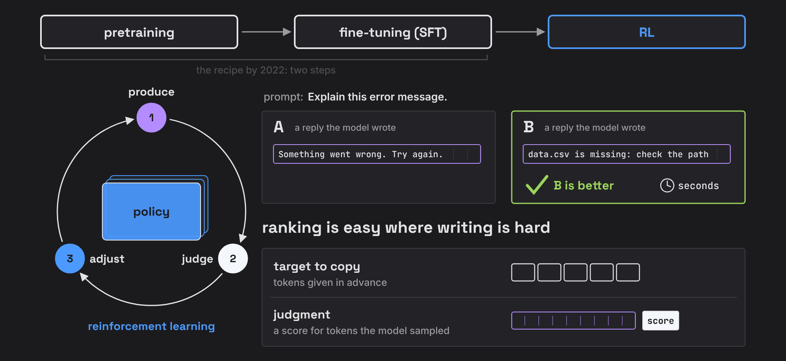

## RLHF: the recipe that made it work

The recipe is RLHF, reinforcement learning from human feedback, best known from the 2022 InstructGPT paper ([arXiv 2203.02155](https://arxiv.org/abs/2203.02155)). Three steps:

1. **Demonstrations -> supervised fine-tuning.** About 13k prompts with answers written by people. Ordinary fine-tuning; it gives a starting policy.
2. **Comparisons -> a reward model.** For about 33k prompts a labeler ranks 4 to 9 answers, and a second network learns to score the preferred answer of every pair higher. The taste of about 40 labelers is now stored in a network.
3. **PPO against the reward model.** The policy answers about 31k new prompts with no human in the loop; the reward model scores, and proximal policy optimization (PPO) turns the scores into weight updates.

Step 2's loss comes back in DPO; for one ranked pair (a sketch, ours):

```python
loss = -F.logsigmoid(reward_model(x, y_chosen) - reward_model(x, y_rejected))
```

PPO was not built for language: it was published in 2017 ([arXiv 1707.06347](https://arxiv.org/abs/1707.06347)) and tested on simulated robots and Atari. What it offers is stability; it limits how far one update can move the policy. People preferred the answers of a 1.3B-parameter model trained this way over those of the 175B GPT-3, more than a hundred times larger. Later that year ChatGPT was trained, in the words of its [launch post](https://openai.com/index/chatgpt/), "using the same methods as InstructGPT, but with slight differences in the data collection setup".

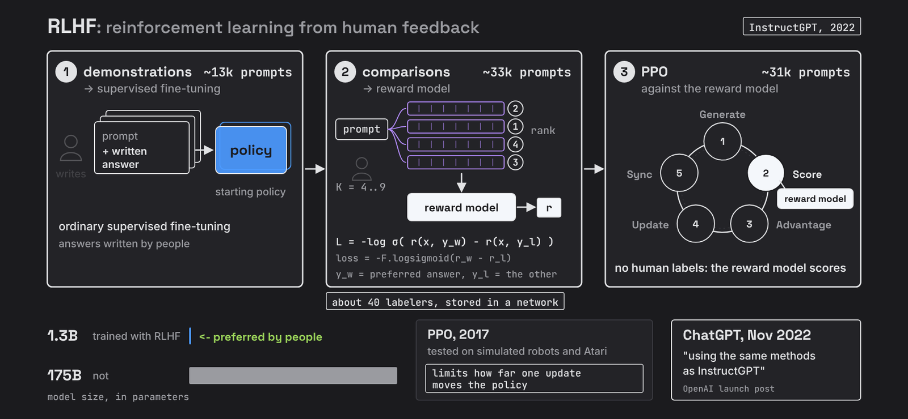

## Three eras, and what each one removed

That recipe costs people; models (a policy, a reward model and, as we will see, a frozen reference and a critic); and a slow loop that generates text every step. The next few years removed those costs one at a time:

| Era | Method | Where the score comes from | What it removed |
|---|---|---|---|
| 2022 | RLHF with PPO | a reward model learned from rankings | nothing yet |
| 2023 | DPO | the ranked pairs, used directly | the reward model, generation during training, the RL loop (it keeps a frozen reference) |
| 2024 -> 2025 | GRPO, then DeepSeek-R1 | a learned reward model in the GRPO paper; a rule in R1 | the critic |

GRPO was introduced in the DeepSeekMath paper with a learned reward model; the rule reward belongs to DeepSeek-R1.

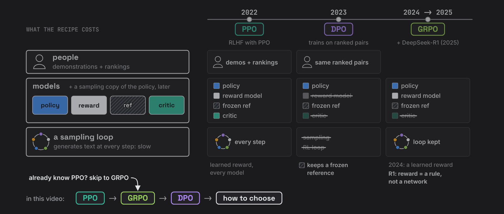

We take them in the order that builds: PPO, because the other two are PPO with parts removed, then GRPO, then DPO. If you know PPO, skip to the DeepSeek-R1 section.

## Two questions, and the scorer is a slot

One thing trips people up. Every setup answers two separate questions: **where does the score come from**, and **how does the score become a weight update**? PPO, GRPO and DPO answer the second. RLHF answers the first: from people.

In the loop the model writes an answer, a scorer turns it into one number, and the update uses that number. The scorer is a slot:

```python
# ours: two things that fit the same slot
# people ranked answers once; a network learned their taste
def rlhf_scorer(prompt, answer):
    # a real number: a matter of degree, and it can be fooled
    return reward_model(prompt, answer)

# our math problem
def rule_scorer(prompt, answer):
    # exactly 1 or 0; needs a right answer to check
    return compute_score(answer, ground_truth[prompt])

scores = [scorer(prompt, a) for a in answers]  # from here on, only floats
```

In ChatGPT's training the slot held a reward model, which measures preference; in our example it holds a rule, which measures correctness. Swap one for the other and nothing after the slot changes. We use the rule because it lets us show every number.

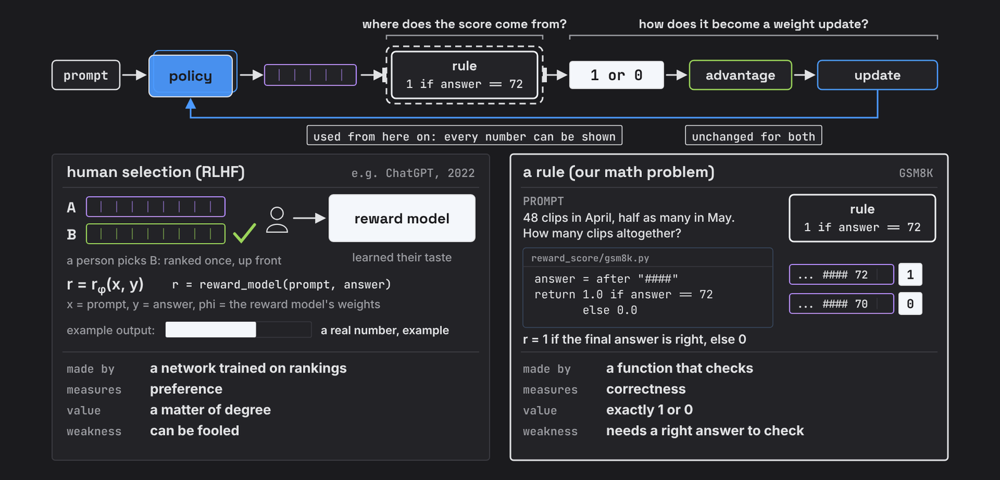

## The vocabulary

RL names map onto a language model in a slightly surprising way:

| RL term | In a language model | In verl |
|---|---|---|
| policy | the model being trained | the actor |
| state | the prompt plus every token generated so far | |
| action | the next token | |
| episode | one complete response | |
| environment | append the token (almost trivial) | |
| trajectory | prompt, sampled tokens, their log-probs, and the reward | rollout, or sample |
| reward | one scalar on the last token of the response | `token_level_scores` |

In multi-turn agent training a trajectory also includes tool calls and their outputs, but only the model's own tokens are trained on. The reward is sparse: one number on the last token, zero on every other, whatever the scorer.

### The two curves on every dashboard

Average the scores over a step and you get one point on the **reward curve**; for us, the fraction correct. It should climb and level off. Flat means no learning; suspiciously fast, especially with a learned reward model, can mean the model is gaming the scorer.

The second curve is **entropy**: how spread out the model's next-token distribution is at each position. verl logs the average entropy of the generated tokens every step ([`verl/utils/torch_functional.py:231-245`](https://github.com/verl-project/verl/blob/3fdf2b5488/verl/utils/torch_functional.py#L231-L245), docstring trimmed):

```python
def entropy_from_logits(logits: torch.Tensor) -> torch.Tensor:
    pd = torch.nn.functional.softmax(logits, dim=-1)
    entropy = torch.logsumexp(logits, dim=-1) - torch.sum(pd * logits, dim=-1)
    return entropy

# ours: a fair choice between two tokens, and one token at 0.99
fair = torch.tensor([0.5, 0.5]).log()
sure = torch.tensor([0.99, 0.01]).log()
# log 2, and near zero
print(f"{entropy_from_logits(fair).item():.3f}",
      f"{entropy_from_logits(sure).item():.3f}")
```

```text
0.693 0.056
```

A slow decline is healthy. A collapse to nearly zero means the model writes the same answer every time, stops exploring, and the reward curve stalls. A close cousin is **perplexity**, which scores only the sampled tokens: the exponential of their average negative log-probability.

```python
logp = torch.tensor([-0.4, -1.0, -0.7, -0.7])         # mean -0.7
# about 2: as unsure as a fair two-way choice
print(f"{torch.exp(-logp.mean()).item():.2f}")
```

```text
2.01
```

verl computes it with the trainer's and with the sampler's probabilities (two copies, see below) and logs the ratio ([`rollout_corr_helper.py:944-990`](https://github.com/verl-project/verl/blob/3fdf2b5488/verl/trainer/ppo/rollout_corr_helper.py#L944-L990)). With matching weights and numerics it sits at 1.

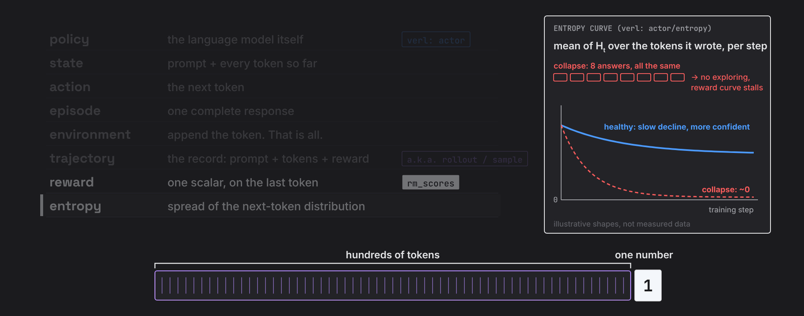

## Advantage: RL is weighted fine-tuning

How does one number become a gradient? Take the log-probability of every token the model produced and push it up or down in proportion to the **advantage**: how much better this outcome was than what we expected from here.

You already know this loss. Fine-tuning minimizes minus the log-probability of every training token; the policy-gradient loss is the same sum over the model's own sample, each term multiplied by its advantage. Set every advantage to 1 and it is fine-tuning on your own samples:

```python
torch.manual_seed(0)

# ours: one answer of 7 tokens, logits from a toy "model", vocabulary of 10
logits = torch.randn(7, 10, requires_grad=True)
tokens = torch.tensor([3, 1, 4, 1, 5, 9, 2])  # the model's own sampled answer
logp = torch.log_softmax(logits, -1).gather(-1, tokens[:, None]).squeeze(-1)

sft_loss = -logp.mean()        # fine-tuning: cross-entropy on these tokens
A = torch.ones(7)              # every advantage set to 1
pg_loss = -(A * logp).mean()   # policy gradient, advantage-weighted
print(torch.allclose(sft_loss, pg_loss))

# verl's form: -A * ratio with ratio = exp(logp - old_logp);
# at ratio = 1 its gradient is the same
ratio = torch.exp(logp - logp.detach())  # old_logp = logp: ratio = 1
A = torch.tensor([1.21] * 7)
g1, = torch.autograd.grad(-(A * ratio).mean(), logits, retain_graph=True)
g2, = torch.autograd.grad(-(A * logp).mean(), logits)
print(torch.allclose(g1, g2))
```

```text
True
True
```

So RL, here, is **advantage-weighted fine-tuning**: the advantage decides which of the model's own tokens to reinforce and which to push away.

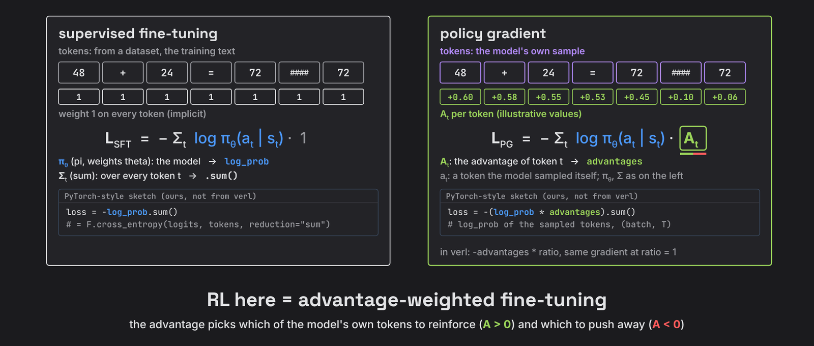

The advantage is stored per token, shape `(batch, response_length)`; a critic gives every token its own value, a group baseline (GRPO) gives all tokens of an answer the same one. Why "better than expected" and not the raw reward? If every answer to an easy question scores 1, pushing them all up teaches almost nothing and adds variance. Subtracting a baseline, an estimate of the expected reward, keeps the average gradient direction and cuts the variance dramatically. PPO, GRPO and the long list of estimators in verl (it registers 14) are mostly different answers to one question: where does the baseline come from?

## PPO: the building blocks

### Two copies of the model

There are two copies of the model: the **trainer**, with weights, gradients and optimizer state, and the **sampler**, an inference engine such as vLLM. The sampler generates one big batch; the trainer splits it into mini-batches with one optimizer step each. verl's GSM8K GRPO example ([`run_qwen3_8b_fsdp.sh:28-40`](https://github.com/verl-project/verl/blob/3fdf2b5488/examples/grpo_trainer/run_qwen3_8b_fsdp.sh#L28-L40)) uses 1024 questions with 5 answers each (8 in our example) and mini-batches of 256 questions with all their answers: four weight updates per batch. The shape of it (a sketch, ours):

```python
# one big batch, current weights W0
batch = sampler.generate(prompts, n=5)
# recorded once, before any update, no grad
batch["old_log_probs"] = actor.log_prob(batch)
# 4 mini-batches -> 4 optimizer steps
for mini in batch.split(256):
    # micro-batches change memory use, not the math
    for micro in mini.split(micro_bsz):
        # their gradients add up
        actor_loss(micro).backward()
    optimizer.step(); optimizer.zero_grad()
# only now does the sampler see new weights
sampler.load_weights(actor)
```

Why split? Sampling is the bottleneck, and each optimizer step moves the weights by roughly one learning rate whatever the batch size, so four steps of 256 get four moves from the same samples. One update per batch is on-policy but wasteful; dozens train on stale data. With the default of one PPO epoch, each sequence is used in exactly one update.

The cost is staleness: from update two on, the remaining mini-batches were sampled by weights that no longer exist. And even on update one, the inference engine's kernels and precision differ, so its probabilities are not bit-identical to the trainer's.

<video controls loop muted autoplay playsinline preload="metadata" width="100%" poster="/assets/images/rl-primer-rlhf-ppo-grpo-dpo/two-copies-poster.png">
  <source src="/assets/images/rl-primer-rlhf-ppo-grpo-dpo/two-copies.webm" type="video/webm">
  <source src="/assets/images/rl-primer-rlhf-ppo-grpo-dpo/two-copies.mp4" type="video/mp4">
</video>

_Trainer and sampler drift out of registration over four updates on one batch, and snap back when the weights are synced._

### The ratio and the clip

The fix is a per-token importance ratio, current probability over the probability under the weights that sampled it: `exp(log_prob - old_log_prob)`, against old log-probs recorded once before the first update. PPO's loss per token is minus the smaller of ratio x advantage and clipped ratio x advantage. This is verl's version ([`verl/trainer/ppo/core_algos.py:1336-1361`](https://github.com/verl-project/verl/blob/3fdf2b5488/verl/trainer/ppo/core_algos.py#L1336-L1361), re-wrapped to fit the page), which writes the minimum of the objective as a maximum of losses:

```python
    negative_approx_kl = log_prob - old_log_prob
    # Clamp negative_approx_kl for stability
    negative_approx_kl = torch.clamp(negative_approx_kl, min=-20.0, max=20.0)
    ratio = torch.exp(negative_approx_kl)
    ppo_kl = verl_F.masked_mean(-negative_approx_kl, response_mask)

    pg_losses1 = -advantages * ratio
    if cliprange_low is None:
        cliprange_low = cliprange
    if cliprange_high is None:
        cliprange_high = cliprange
    pg_losses2 = -advantages * torch.clamp(
        ratio, 1 - cliprange_low, 1 + cliprange_high
    )  # - clip(ratio, 1-cliprange, 1+cliprange) * A
    clip_pg_losses1 = torch.maximum(
        pg_losses1, pg_losses2
    )  # max(-ratio * A, -clip(ratio, 1-cliprange, 1+cliprange) * A)
    pg_clipfrac = verl_F.masked_mean(
        torch.gt(pg_losses2, pg_losses1).float(), response_mask
    )

    pg_losses3 = -advantages * clip_ratio_c
    clip_pg_losses2 = torch.min(pg_losses3, clip_pg_losses1)
    pg_clipfrac_lower = verl_F.masked_mean(
        torch.gt(clip_pg_losses1, pg_losses3) * (advantages < 0).float(),
        response_mask
    )

    pg_losses = torch.where(advantages < 0, clip_pg_losses2, clip_pg_losses1)
```

The defaults are `clip_ratio: 0.2` on both sides, a band from 0.8 to 1.2, and `clip_ratio_c: 3.0`. Wrap those lines as `ppo_token_losses(log_prob, old_log_prob, advantages, response_mask)` and run them on the `72` at the end of a correct answer, sampled at 0.50 with advantage +1. In mini-batch B one update has lifted it to 0.58; in mini-batch D three updates have lifted it to 0.65:

```python
old = torch.tensor([0.50, 0.50]).log()
new = torch.tensor([0.58, 0.65]).log().requires_grad_()
A = torch.tensor([1.0, 1.0])
loss, ratio = ppo_token_losses(new, old, A, torch.ones(2))
grad, = torch.autograd.grad(loss.sum(), new)
print("ratio", ratio.detach().numpy().round(2))
print("loss ", loss.detach().numpy().round(2))
print("grad ", grad.numpy().round(2))                  # d loss / d log_prob
```

```text
ratio [1.16 1.3 ]
loss  [-1.16 -1.2 ]
grad  [-1.16  0.  ]
```

At 1.16 the token is inside the band and its gradient keeps pushing the log-probability up. At 1.30 the minimum picks the clipped term, a constant, and the push stops. For a negative advantage it mirrors, and the dual clip caps a token whose ratio explodes:

```python
new = torch.tensor([0.45, 0.35, 0.50]).log().requires_grad_()
old = torch.tensor([0.50, 0.50, 0.05]).log()  # the last one was a 5% long shot
A = torch.tensor([-1.0, -1.0, -1.0])
# ... the same call and prints as above
```

```text
ratio [ 0.9  0.7 10. ]
loss  [0.9 0.8 3. ]
grad  [0.9 0.  0. ]
```

Below 0.8 the push down stops, and the long shot's loss of 10 is capped at 3 x |A|. The clip is a cheap trust region: improve, but not far from the policy that collected the data. Since the ratio always compares with the sampling weights, the band limits the total drift over all four updates, which is why too many updates per batch backfire: more tokens land outside the band and their gradients go flat.

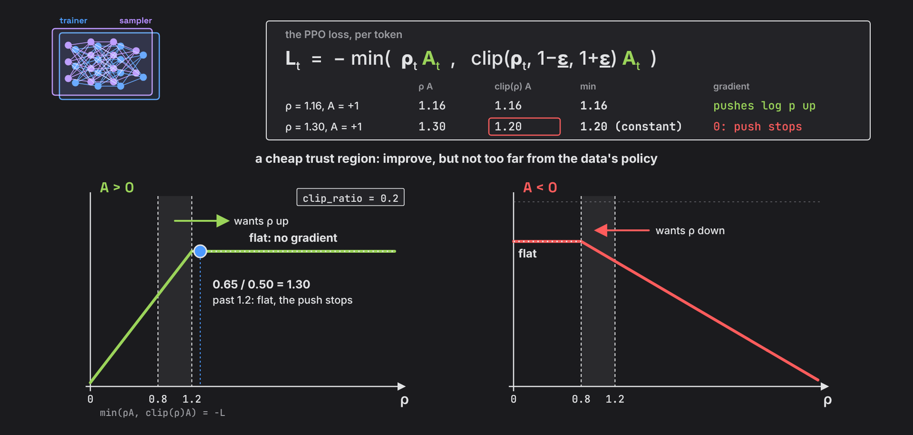

### The leash: KL to a frozen reference

The ratio keeps each update local. To keep the whole run from wandering off there is the **reference model**, a frozen copy of the starting model. The KL divergence measures how far the policy has moved from it; per token it comes down to two log-probabilities. The ratio compares with the sampling weights of a few updates ago; KL compares with the start. verl implements the usual per-token estimators ([`core_algos.py:2228-2245`](https://github.com/verl-project/verl/blob/3fdf2b5488/verl/trainer/ppo/core_algos.py#L2228-L2245); two branches and a citation comment trimmed):

```python
    if kl_penalty in ("kl", "k1"):
        return logprob - ref_logprob

    if kl_penalty in ("mse", "k2"):
        return 0.5 * (logprob - ref_logprob).square()

    if kl_penalty in ("low_var_kl", "k3"):
        kl = ref_logprob - logprob
        # For numerical stability
        kl = torch.clamp(kl, min=-20, max=20)
        ratio = torch.exp(kl)
        kld = (ratio - kl - 1).contiguous()
        return torch.clamp(kld, min=-10, max=10)
```

If the policy now gives a token 0.60 where the reference gives 0.30:

```python
lp, ref = torch.tensor(0.60).log(), torch.tensor(0.30).log()
for k in ("k1", "k2", "k3"):
    print(k, round(kl_penalty_forward(lp, ref, k).item(), 3))
```

```text
k1 0.693
k2 0.24
k3 0.193
```

k1 is the plain log of the ratio, about 0.7. The default for the loss is k3, `low_var_kl`: always non-negative and much less noisy than k1.

The penalty discourages reward hacking, odd language and collapse onto one style. It is optional: verl only creates the reference model if a KL term is on, and both switches default to off ([`verl/trainer/ppo/utils.py:75-79`](https://github.com/verl-project/verl/blob/3fdf2b5488/verl/trainer/ppo/utils.py#L75-L79), re-wrapped to fit the page):

```python
def need_reference_policy(
    config: DictConfig,
) -> bool:
    """Given the config, do we need ref policy."""
    return config.algorithm.get("use_kl_in_reward", False) \
        or config.actor_rollout_ref.actor.use_kl_loss
```

Classic PPO subtracts the KL from the reward (`use_kl_in_reward`); GRPO-style training adds it to the loss (`use_kl_loss`), commonly with `kl_loss_coef: 0.001`. DAPO and verl's Dr. GRPO recipe drop it: a rule reward has less to hack, reasoning wants to move far from the start, and no reference saves a model's memory and a forward pass per step. DPO goes the other way: the reference is built into its loss. An optional entropy bonus exists too; most GRPO recipes set `entropy_coeff` to 0 and rely on a higher upper clip and the KL leash instead, and verl logs entropy every step regardless.

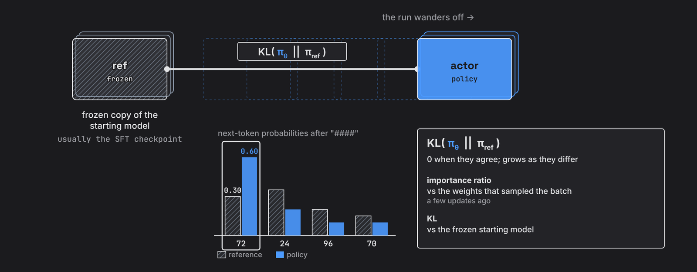

### The critic and GAE

Back to the baseline. Classic PPO gets it from a **critic**: a second network, usually as large as the policy, whose scalar head predicts at every token the reward to expect from there. Advantages come from generalized advantage estimation, GAE ([arXiv 1506.02438](https://arxiv.org/abs/1506.02438)). Its building block is `delta`, the critic's one-step surprise: this token's reward, plus the guess at the next token, minus the guess here. GAE blends those surprises backwards through the response, with `gamma` (discount) and `lam` (how far back each surprise reaches). verl's loop ([`core_algos.py:244-263`](https://github.com/verl-project/verl/blob/3fdf2b5488/verl/trainer/ppo/core_algos.py#L244-L263), re-wrapped to fit the page):

```python
    with torch.no_grad():
        nextvalues = 0
        lastgaelam = 0
        advantages_reversed = []
        gen_len = token_level_rewards.shape[-1]

        for t in reversed(range(gen_len)):
            delta = token_level_rewards[:, t] + gamma * nextvalues \
                - values[:, t]
            lastgaelam_ = delta + gamma * lam * lastgaelam

            # skip values and TD-error on observation tokens
            nextvalues = values[:, t] * response_mask[:, t] \
                + (1 - response_mask[:, t]) * nextvalues
            lastgaelam = lastgaelam_ * response_mask[:, t] \
                + (1 - response_mask[:, t]) * lastgaelam

            advantages_reversed.append(lastgaelam)
        advantages = torch.stack(advantages_reversed[::-1], dim=1)

        returns = advantages + values
        advantages = verl_F.masked_whiten(advantages, response_mask)
    return advantages, returns
```

verl's defaults are `gamma: 1.0` and `lam: 1.0`, and the reward sits only on the last token, so the sum collapses: every middle guess is added once and subtracted once, leaving the final reward minus the guess at this token. Run it, without the final whitening, on our correct answer `48 + 24 = 72 #### 72` as 7 tokens, with illustrative critic values rising from 0.4 to 0.94:

```python
rewards = torch.tensor([[0, 0, 0, 0, 0, 0, 1.0]])
values  = torch.tensor([[0.40, 0.55, 0.65, 0.75, 0.85, 0.90, 0.94]])
adv, ret = gae(rewards, values, torch.ones(1, 7))
print("advantages", adv.numpy().round(2))
print("returns   ", ret.numpy().round(2))
```

```text
advantages [[0.6  0.45 0.35 0.25 0.15 0.1  0.06]]
returns    [[1. 1. 1. 1. 1. 1. 1.]]
```

Every token gets its own advantage: big while the outcome looked uncertain, almost none once it was clear. The return, advantage plus value, is the reward still to come; with one undiscounted reward at the end it is 1 on every token of a correct answer and 0 on a wrong one. The critic regresses onto the returns, with its own clipped loss.

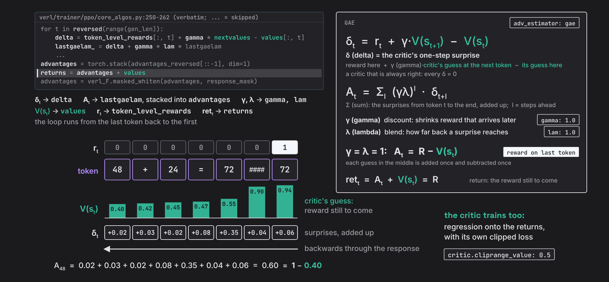

### One PPO step through four models

Follow one PPO step through all four models.

1. **Generate and score.** The prompt asks for reasoning ending in `####` and the answer, so the checker can find it. Ours ends `#### 72`; compared with the ground truth (which the model never sees) it scores 1, on the last token.
2. **Three forward passes, no gradients.** Token ids travel, not the sampler's probabilities. The actor gives the final `72` 0.5 (log -0.7): the old log-probs. The reference gives it 0.3 (log -1.2), for the KL. The critic predicts the values above.
3. **The driver** runs GAE: +0.6 on the first token, returns of 1. The reward splits here: the actor sees only advantages, the critic gets returns as its target. verl then whitens the advantages over the batch ([`masked_whiten`](https://github.com/verl-project/verl/blob/3fdf2b5488/verl/utils/torch_functional.py#L329-L346)); the example keeps the raw 0.6.
4. **Two models train**, each with a second forward pass, gradients on. Say `48`, the first token, was sampled at 0.40 and an update has raised it to 0.44:

```python
# 1.0 and 0.6, from the GAE run above
ret0, adv0 = ret[0, 0].item(), adv[0, 0].item()

# critic: half the squared error to the return
# (verl's compute_value_loss, before its clip)
v = torch.tensor(0.40, requires_grad=True)
vf_loss = 0.5 * (v - ret0) ** 2
vf_loss.backward()
print(f"critic loss {vf_loss.item():.2f}  d/dV {v.grad.item():.2f}")

# actor: "48" was sampled at 0.40, an update has raised it to 0.44;
# one position's logits, "48" first
logits = torch.tensor([0.44, 0.30, 0.16, 0.10]).log().requires_grad_()
logp = torch.log_softmax(logits, -1)[0]
ratio = torch.exp(logp - torch.tensor(0.40).log())      # inside the band
term = -ratio * adv0
term.backward()
print(f"ratio {ratio.item():.2f}  term {term.item():.2f}")
print("d term / d logits", logits.grad.numpy().round(2))
```

```text
critic loss 0.18  d/dV -0.60
ratio 1.10  term -0.66
d term / d logits [-0.37  0.2   0.11  0.07]
```

The critic's gradient, value minus return, is -0.6, so its value moves up toward 1. For the actor, the term's derivative with respect to the log-prob is the term itself, -0.66; through the softmax the logit of `48` gets -0.66 x (1 - 0.44), about -0.37, and goes up, while every other logit gets +0.66 times its probability and goes down. Past a ratio of 1.2 all of these would be zero.

Step 5 is the **sync**: the actor's new weights are copied to the rollout copy.

<video controls loop muted autoplay playsinline preload="metadata" width="100%" poster="/assets/images/rl-primer-rlhf-ppo-grpo-dpo/ppo-step-poster.png">
  <source src="/assets/images/rl-primer-rlhf-ppo-grpo-dpo/ppo-step.webm" type="video/webm">
  <source src="/assets/images/rl-primer-rlhf-ppo-grpo-dpo/ppo-step.mp4" type="video/mp4">
</video>

_One PPO step: token ids fan out to the actor, the reference and the critic; their per-token rows go to the driver; advantages and returns come back._

Four large models, two of them training. And the critic is hard to train on sparse rewards: with the only signal at the last token, a good value for token seventeen is genuinely difficult. Can we get the baseline without a critic?

## DeepSeek-R1: a reward you can check

On January 20, 2025, DeepSeek released R1 ([arXiv 2501.12948](https://arxiv.org/abs/2501.12948)), a model that reasons before it answers. Its research sibling **R1-Zero** started from the pretrained DeepSeek-V3-Base and was trained with RL only: no reasoning examples to imitate, no supervised fine-tuning first.

The reward was not a network. It was two rules:

- **accuracy:** for math, is the final answer in the box correct; for code, do the test cases pass
- **format:** is the reasoning between `<think>` and `</think>`

The paper says a neural reward model "may suffer from reward hacking"; a rule that checks the answer cannot be flattered. Our GSM8K scorer is the same kind of rule, and it removes all of RLHF's step 2: no rankings, no reward model to train, host or distrust.

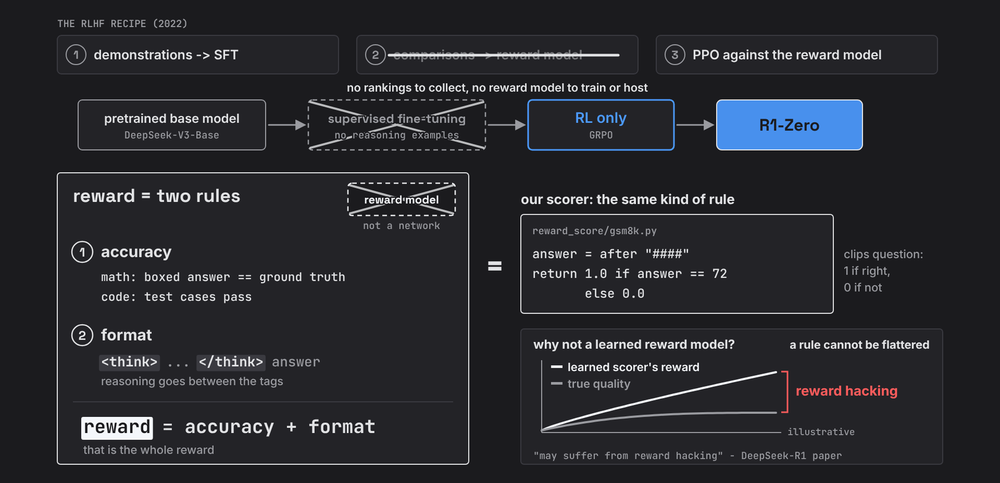

### What came out, and what it took

On AIME 2024, R1-Zero's pass@1 (solved on the first try) rose from 15.6% at the start of training to 77.9% at the end. That is the current version of the paper (v2, and the Nature version); the January 2025 preprint reported 71.0%.

Its answers also got longer, though nothing in the reward asks for length (in v2, part of that follows a raise of the maximum generation length from 32,768 to 65,536 tokens at step 8.2k). Generation is where the time goes, and it gets more expensive as the run succeeds. The settings (values from the paper; key names ours):

```text
samples_per_question = 16
questions_per_step   = 32         # 512 answers per step
temperature          = 1.0
# toward a reference replaced by the current policy every 400 steps
kl_coef              = 0.001
steps                = 10_400
```

One caution: the released R1 is not pure RL. It adds cold-start fine-tuning on thousands of long reasoning examples, reasoning RL, fine-tuning on about 600k reasoning and 200k non-reasoning samples, and a last RL stage with learned reward models for prompts no rule can check. Rules cover what can be verified; preferences still need a judge.

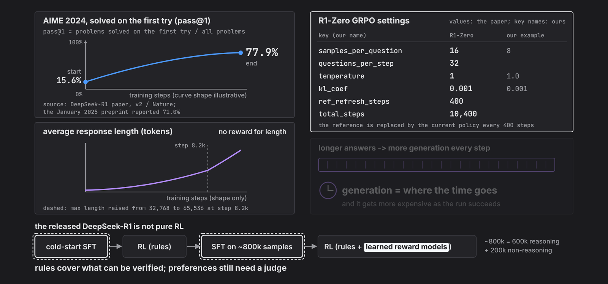

And there is no critic: sixteen answers per question were enough to tell which were better than expected.

## GRPO: the group is the baseline

GRPO, group relative policy optimization, from the DeepSeekMath paper ([arXiv 2402.03300](https://arxiv.org/abs/2402.03300)): sample several answers per prompt and let the group be the baseline. verl samples at `temperature: 1.0` by default, so the group shows what the policy really believes. The whole estimator ([`core_algos.py:304-331`](https://github.com/verl-project/verl/blob/3fdf2b5488/verl/trainer/ppo/core_algos.py#L304-L331), re-wrapped to fit the page), where `index` holds a prompt id per answer:

```python
    scores = token_level_rewards.sum(dim=-1)

    id2score = defaultdict(list)
    id2mean = {}
    id2std = {}

    with torch.no_grad():
        bsz = scores.shape[0]
        for i in range(bsz):
            id2score[index[i]].append(scores[i])
        for idx in id2score:
            if len(id2score[idx]) == 1:
                id2mean[idx] = torch.tensor(0.0)
                id2std[idx] = torch.tensor(1.0)
            elif len(id2score[idx]) > 1:
                scores_tensor = torch.stack(id2score[idx])
                id2mean[idx] = torch.mean(scores_tensor)
                id2std[idx] = torch.std(scores_tensor)
            else:
                raise ValueError(f"no score in prompt index: {idx}")
        for i in range(bsz):
            if norm_adv_by_std_in_grpo:
                scores[i] = (scores[i] - id2mean[index[i]]) \
                    / (id2std[index[i]] + epsilon)
            else:
                scores[i] = scores[i] - id2mean[index[i]]
        scores = scores.unsqueeze(-1) * response_mask

    return scores, scores
```

Wrapped as `grpo_advantage(token_level_rewards, response_mask, index, epsilon=1e-6, norm_adv_by_std_in_grpo=True)` and run on our eight answers:

```python
# ours: eight answers to the clips question, 7 tokens each,
# the score on the last token
R = torch.tensor([1., 0, 0, 1, 0, 0, 1, 0])
def as_tokens(R):
    r = torch.zeros(8, 7); r[:, -1] = R
    return r
mask, uid = torch.ones(8, 7), ["clips"] * 8

print(f"mean {R.mean():.3f}  std {R.std():.4f}  (divides by n - 1 = 7)  "
      f"std over n {R.std(correction=0):.3f}")
adv, _ = grpo_advantage(as_tokens(R), mask, uid)
print("advantages per answer", adv[:, 0].numpy().round(2))
print("answer 0, every token", adv[0].numpy().round(2))
```

```text
mean 0.375  std 0.5175  (divides by n - 1 = 7)  std over n 0.484
advantages per answer [ 1.21 -0.72 -0.72  1.21 -0.72 -0.72  1.21 -0.72]
answer 0, every token [1.21 1.21 1.21 1.21 1.21 1.21 1.21]
```

The standard deviation is about 0.52 because `torch.std` divides by n - 1. Each correct answer gets +1.21 and each wrong one -0.72 on every token: GRPO gives up per-token credit and judges the answer as a whole (the ratio and clip still act per token). The loss is PPO's clipped loss plus the KL term, and `return scores, scores` says it: with no critic, returns are the advantages.

<video controls loop muted autoplay playsinline preload="metadata" width="100%" poster="/assets/images/rl-primer-rlhf-ppo-grpo-dpo/group-baseline-poster.png">
  <source src="/assets/images/rl-primer-rlhf-ppo-grpo-dpo/group-baseline.webm" type="video/webm">
  <source src="/assets/images/rl-primer-rlhf-ppo-grpo-dpo/group-baseline.mp4" type="video/mp4">
</video>

_Eight answers, scores 1 0 0 1 0 0 1 0, a mean line at 0.375: correct answers wash to +1.21 on every token, wrong ones to -0.72._

No critic means no second trained network. And if all eight answers get the same score, the prompt contributes nothing:

```python
adv, _ = grpo_advantage(as_tokens(torch.ones(8)), mask, uid)  # all eight right
print("all correct          ", adv[:, 0].numpy().round(2))
```

```text
all correct           [0. 0. 0. 0. 0. 0. 0. 0.]
```

That is what entropy collapse does to GRPO; it learns only from prompts at the edge of the model's ability. DAPO's **dynamic sampling** filters out groups with identical scores and keeps generating until the batch is full of mixed ones. In verl that is `algorithm.filter_groups.enable=True` ([`docs/algo/dapo.md`](https://github.com/verl-project/verl/blob/3fdf2b5488/docs/algo/dapo.md)).

Does it work? In verl's published GSM8K scores ([`docs/algo/baseline.md`](https://github.com/verl-project/verl/blob/3fdf2b5488/docs/algo/baseline.md)), Qwen2.5-0.5B-Instruct solves 49.6% as released (a figure verl takes from the model's release blog), and after training on these ones and zeros, 56.7% with PPO and 54.3% with GRPO on a rank-32 LoRA adapter.

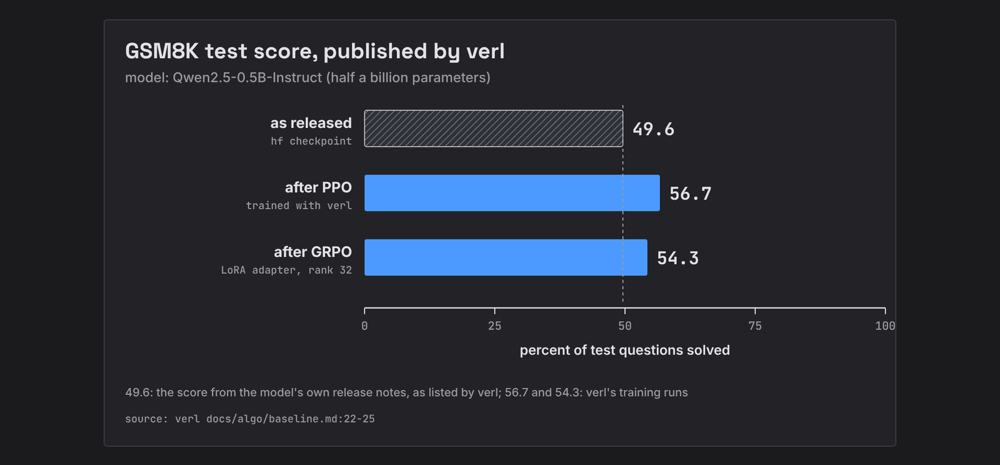

### One GRPO step

The same five steps with the same answer, so you can see what changes.

1. **Generate and score** a group of eight answers, all tagged with one prompt id: 1, 0, 0, 1, 0, 0, 1, 0.
2. **Two forward passes**, no gradients: the actor's old log-probs (log 0.5 for our final `72`) and the reference's (log 0.3). No critic, no value pass.
3. **The driver** groups by prompt id: +1.21 on all seven tokens of our answer.
4. **Only the actor trains**, with its own pass, because the passes run on different weights: step 2 ran once on W0 and saved old log-probs for all four mini-batches; update one (mini-batch A) turns W0 into W1; our answer, in mini-batch B, trains on W1, when W0's 0.5 exists only in the snapshot.
5. **Sync**, exactly as in PPO.

Step 4 for the final `72`, at 0.50 under W0, 0.58 under W1, and 0.30 under the reference:

```python
# "72" first, under W1
logits = torch.tensor([0.58, 0.17, 0.10, 0.15]).log().requires_grad_()
logp = torch.log_softmax(logits, -1)[0]
old_logp, ref_logp = torch.tensor(0.50).log(), torch.tensor(0.30).log()
A, kl_coef = 1.2076, 0.001

ratio = torch.exp(logp - old_logp)  # 1.16, inside [0.8, 1.2]: no clipping
pg = -ratio * A
# k3 / low_var_kl, as in kl_penalty_forward above
r = ref_logp - logp
kl = torch.exp(r) - r - 1
loss = pg + kl_coef * kl

g_logp, = torch.autograd.grad(loss, logp, retain_graph=True)
loss.backward(retain_graph=True)
print(f"ratio {ratio.item():.2f}  pg {pg.item():.2f}  r {r.item():.2f}  "
      f"k3 {kl.item():.2f}  loss {loss.item():.4f}")
print(f"d loss / d logp {g_logp.item():.4f}  "
      f"(KL part {kl_coef * (1 - 0.30 / 0.58):+.5f})")
print("d loss / d logits", logits.grad.numpy().round(2))
```

```text
ratio 1.16  pg -1.40  r -0.66  k3 0.18  loss -1.4006
d loss / d logp -1.4003  (KL part +0.00048)
d loss / d logits [-0.59  0.24  0.14  0.21]
```

The clipped term contributes -1.40, the KL term a tiny pull back toward the reference, about +0.0005; the logit of `72` gets about -0.59 and goes up.

<video controls loop muted autoplay playsinline preload="metadata" width="100%" poster="/assets/images/rl-primer-rlhf-ppo-grpo-dpo/grpo-step-poster.png">
  <source src="/assets/images/rl-primer-rlhf-ppo-grpo-dpo/grpo-step.webm" type="video/webm">
  <source src="/assets/images/rl-primer-rlhf-ppo-grpo-dpo/grpo-step.mp4" type="video/mp4">
</video>

_One GRPO step: a group of eight answers, two forward passes, the driver groups by prompt id, and only the actor trains._

### Without a reference

With both KL switches off (DAPO, verl's Dr. GRPO recipe), `need_reference_policy` returns `False`, verl never builds the reference worker, step 2 is one pass, and the loss loses its second term:

```python
# the clip term alone
g_noref, = torch.autograd.grad(pg, logp, retain_graph=True)
print(f"no reference: loss {pg.item():.4f}  "
      f"d loss / d logp {g_noref.item():.4f}")
```

```text
no reference: loss -1.4008  d loss / d logp -1.4008
```

Now nothing remembers where training started, and over hundreds of steps the policy can drift as far as the reward pulls it. That is the point for long chains of thought, and the risk: a gameable reward will be gamed, style and skills can wander, outputs can narrow. Reference-free recipes rely on rewards that are hard to fool and watch entropy and validation scores.

| Setup | Large models | Trained |
|---|---|---|
| PPO | 4: actor, rollout, reference, critic | 2 |
| GRPO | 3: actor, rollout, reference | 1 |
| GRPO without a reference | 2: actor, rollout | 1 |

That is the whole reason GRPO took over: the group replaced a network.

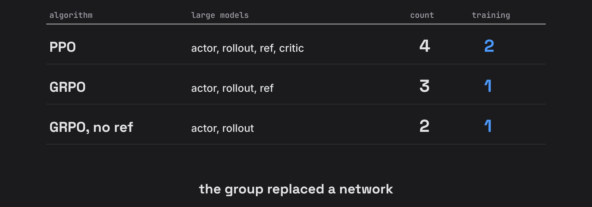

### The knobs that change the objective

Two details of GRPO matter more than they look, and verl exposes both as configuration switches.

**Dividing by the standard deviation** inflates the advantages of prompts that are almost always or almost never solved. A 2025 analysis ([arXiv 2503.20783](https://arxiv.org/abs/2503.20783)) called this a difficulty bias and proposed **Dr. GRPO**: keep the mean, drop the division. In verl, `algorithm.norm_adv_by_std_in_grpo=False` (default `True`):

```python
# Dr. GRPO
adv, _ = grpo_advantage(as_tokens(R), mask, uid, norm_adv_by_std_in_grpo=False)
print("no std (Dr. GRPO)    ", adv[:, 0].numpy().round(3))
```

```text
no std (Dr. GRPO)     [ 0.625 -0.375 -0.375  0.625 -0.375 -0.375  0.625 -0.375]
```

**How per-token losses become one number**, `actor.loss_agg_mode`, implemented by [`agg_loss`](https://github.com/verl-project/verl/blob/3fdf2b5488/verl/trainer/ppo/core_algos.py#L1140-L1206) with five modes. The original GRPO paper averages tokens within each answer, then answers (`seq-mean-token-mean`). The default, `token-mean`, averages over every token in the mini-batch, so long answers weigh in proportion to their length. To see the difference, differentiate verl's `agg_loss` with respect to per-token losses for a 2-token and an 8-token answer, and add up each answer's weight:

```python
mask = torch.tensor([[1., 1, 0, 0, 0, 0, 0, 0],
                     [1., 1, 1, 1, 1, 1, 1, 1]])
for mode in ["token-mean", "seq-mean-token-mean", "seq-mean-token-sum-norm"]:
    loss_mat = torch.ones(2, 8, requires_grad=True)
    agg_loss(loss_mat, mask, mode).backward()
    w = (loss_mat.grad * mask).sum(-1)          # total weight of each answer
    print(f"{mode:24s} short {w[0]:.3f}  long {w[1]:.3f}")
```

```text
token-mean               short 0.200  long 0.800
seq-mean-token-mean      short 0.500  long 0.500
seq-mean-token-sum-norm  short 0.125  long 0.500
```

verl keeps token mean in its GRPO examples, since the per-answer mode can be unstable for long chains of thought; Dr. GRPO uses the third, which divides by a constant. Add a higher upper clip (`clip_ratio_high` above `clip_ratio_low`, DAPO's clip-higher) and you can see why so many GRPO variants are one code path with different settings.

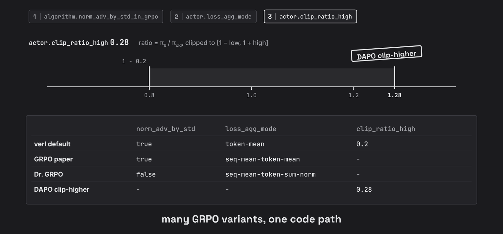

## Back to preferences: why DPO

GRPO needs a rule that can check the answer. Is this reply clear? Polite? The summary you wanted? For those we are back where RLHF started: a person or a stronger model picks the better of two answers. In May 2023 a paper ([Direct Preference Optimization, arXiv 2305.18290](https://arxiv.org/abs/2305.18290)) asked: with pairs in hand, chosen and rejected, can you train on them directly? Yes: no reward model, no sampling during training, no RL loop, though it keeps a frozen reference. It was cheap enough to change who could do it. Zephyr-7B ([arXiv 2310.16944](https://arxiv.org/abs/2310.16944)) was aligned this way from 64k prompts with 4 answers each scored by a stronger model, no human labels, typically in two to four hours on 16 A100s.

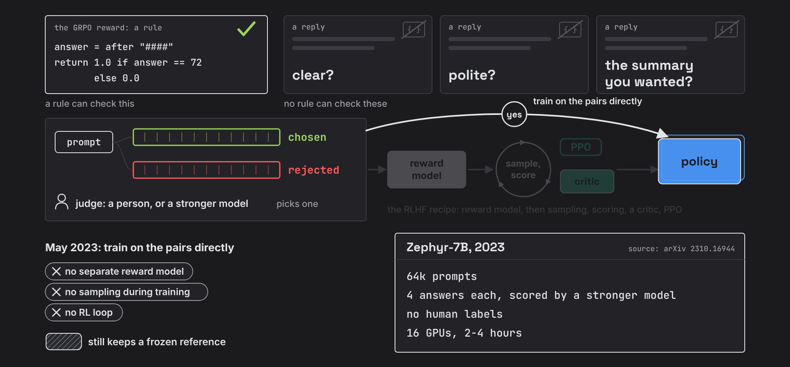

## DPO: the policy is the reward model

DPO starts from PPO's objective, reward minus a KL leash, which has a closed-form optimum. Inverted, the reward is beta times the log of policy over reference plus a prompt-only term; in the reward model's pairwise sigmoid that term cancels. What is left: take the policy's log-ratio to the reference for the chosen and the rejected answer, subtract, scale by beta, minimize minus the log-sigmoid.

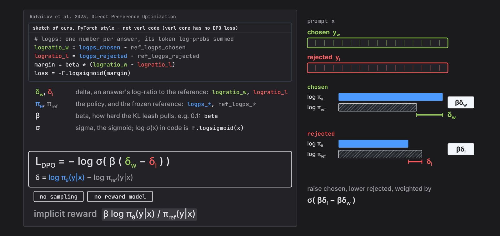

verl core has no DPO trainer. The loss lives in the SPIN recipe of the separate [verl-recipe](https://github.com/verl-project/verl-recipe) repository, with sigmoid and IPO variants ([`spin/core_algos.py:131-158`](https://github.com/verl-project/verl-recipe/blob/21892b92/spin/core_algos.py#L131-L158), trimmed and re-wrapped to fit the page):

```python
def compute_online_dpo_loss(
    policy_chosen_logps: torch.Tensor,
    policy_rejected_logps: torch.Tensor,
    reference_chosen_logps: torch.Tensor,
    reference_rejected_logps: torch.Tensor,
    beta: float,
    label_smoothing: float = 0.0,
    loss_type: str = "sigmoid",
    reference_free: bool = False,
) -> torch.Tensor:
    ...
    pi_logratios = policy_chosen_logps - policy_rejected_logps
    ref_logratios = reference_chosen_logps - reference_rejected_logps
    ...
    logits = pi_logratios - ref_logratios

    if loss_type == "sigmoid":
        losses = -F.logsigmoid(beta * logits) * (1 - label_smoothing) \
            - F.logsigmoid(-beta * logits) * label_smoothing
    elif loss_type == "ipo":
        losses = (logits - 1 / (2 * beta)) ** 2
    ...
    return losses.mean()
```

The implicit reward is beta times the log-ratio to the reference: the policy is its own reward model. The gradient raises the chosen answer and lowers the rejected one, weighted by how wrong the implicit reward currently ranks them.

### One DPO step

Same example, same layout. Chosen: `48 + 24 = 72 #### 72`. Rejected: `48 + 24 = 96 #### 96`.

1. **No rollout, no reward function**: the batch is pairs from a fixed dataset.
2. **The frozen reference** sums each answer's token log-probs. Say the shared start `48 + 24 =` is -1.8 in both; the rest adds -1.4 (chosen, total -3.2) and -2.3 (rejected, total -4.1). This can be precomputed once.
3. **The policy** reads the same answers, gradients on. At step 0 it equals the reference: loss log 2. Later, say the shared start is -1.7 and the rests -1.1 and -3.0: totals -2.8 (0.4 above the reference) and -4.7 (0.6 below).
4. **Loss and gradient:**

```python
# -3.2, -4.1
ref_c, ref_r = torch.tensor([-1.8 - 1.4]), torch.tensor([-1.8 - 2.3])
beta = 0.1
loss = compute_online_dpo_loss(ref_c, ref_r, ref_c, ref_r, beta)
print(f"step 0 loss {loss.item():.4f}  log 2 = {math.log(2):.4f}")

pol_c = torch.tensor([-1.7 - 1.1], requires_grad=True)  # -2.8
pol_r = torch.tensor([-1.7 - 3.0], requires_grad=True)  # -4.7
loss = compute_online_dpo_loss(pol_c, pol_r, ref_c, ref_r, beta)
loss.backward()
m = beta * ((pol_c - ref_c) - (pol_r - ref_r))
print(f"margin {m.item():.2f}  sigmoid {torch.sigmoid(m).item():.3f}  "
      f"loss {loss.item():.3f}")
print(f"d loss / d logp chosen {pol_c.grad.item():+.4f}  "
      f"rejected {pol_r.grad.item():+.4f}")
print(f"implicit rewards: chosen {beta * (pol_c - ref_c).item():+.2f}  "
      f"rejected {beta * (pol_r - ref_r).item():+.2f}")
```

```text
step 0 loss 0.6931  log 2 = 0.6931
margin 0.10  sigmoid 0.525  loss 0.644
d loss / d logp chosen -0.0475  rejected +0.0475
implicit rewards: chosen +0.04  rejected -0.06
```

Margin beta x (0.4 - (-0.6)) = 0.1, sigmoid 0.525, loss 0.644. The margin's gradient is -sigmoid(-0.1) = -0.475, so every token of the chosen answer gets -0.1 x 0.475, about -0.048, and goes up, and every token of the rejected one +0.048. The shared start gets both, summing to zero: only tokens where the answers differ get a signal. The better a pair is already ranked, the smaller the push.

Step 5 has **no sync**: there is no sampler.

<video controls loop muted autoplay playsinline preload="metadata" width="100%" poster="/assets/images/rl-primer-rlhf-ppo-grpo-dpo/dpo-step-poster.png">
  <source src="/assets/images/rl-primer-rlhf-ppo-grpo-dpo/dpo-step.webm" type="video/webm">
  <source src="/assets/images/rl-primer-rlhf-ppo-grpo-dpo/dpo-step.mp4" type="video/mp4">
</video>

_One DPO step: pairs from a dataset, reference log-probs that can be precomputed, the policy's log-probs, the loss, and no sync._

Two large models, the policy and a precomputable reference; no sampler, reward model, critic or advantages. To the systems side DPO is fine-tuning with paired batches. The online variant samples two answers from the current policy, scores them, calls the better one chosen and applies the same loss, which brings back the rollout copy and the sync; it is the version in the verl ecosystem.

## What the reward means, algorithm by algorithm

A reward in verl is one number per finished answer, from **a rule** (the GSM8K scorer; for code, the fraction of tests passed), **a learned reward model** (trained with the same pairwise loss as DPO; judges helpfulness, can be fooled), or **any custom function** (say, correctness plus a format bonus). Each algorithm uses it differently.

**PPO uses it as an absolute target.** With the KL in the reward, each token first pays a penalty, in verl's `apply_kl_penalty` ([`ray_trainer.py:78-117`](https://github.com/verl-project/verl/blob/3fdf2b5488/verl/trainer/ppo/ray_trainer.py#L78-L117)) with the default k1 estimator:

```python
    token_level_rewards = token_level_scores - beta * kld
```

```python
old_logp, ref_logp, beta = math.log(0.50), math.log(0.30), 0.001
kld = old_logp - ref_logp
print(f"KL on the final 72: {kld:.2f}   "
      f"last-token reward: {1 - beta * kld:.4f}")
```

```text
KL on the final 72: 0.51   last-token reward: 0.9995
```

Scale matters for the critic (10x rewards, 10x values); the actor sees rewards only after GAE and whitening.

**GRPO uses it only relative to the group.** Multiply every score by 10 and add 5, and the advantages do not move:

```python
# rescale every reward
adv, _ = grpo_advantage(as_tokens(10 * R + 5), mask, uid)
print("10R + 5              ", adv[:, 0].numpy().round(2))
```

```text
10R + 5               [ 1.21 -0.72 -0.72  1.21 -0.72 -0.72  1.21 -0.72]
```

Only the ranking and relative gaps matter, unless you drop the division (Dr. GRPO).

**DPO has no reward function during training**; the label was decided earlier. Its implicit rewards in the run above, +0.04 and -0.06, differ by exactly the margin 0.1, and sigmoid 0.525 is the probability the model currently gives the chosen answer being better.

So the same word means three things: an absolute target for PPO, a ranking within a group for GRPO, and an implicit score that DPO sets by itself.

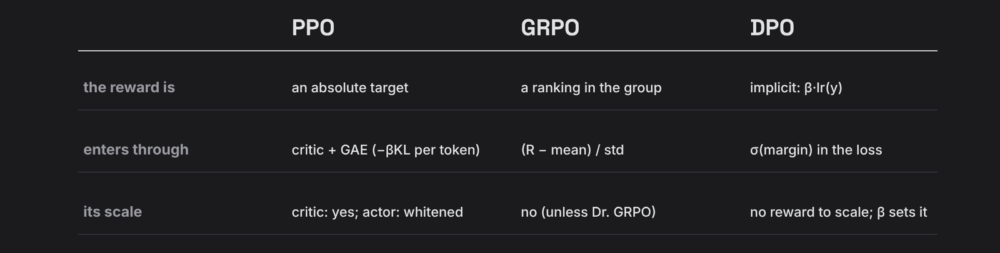

## Which one do I use

Start from the signal you have, not from the algorithm. DPO is offline (fixed pairs, no generation, policy plus reference); GRPO is online (fresh samples every step, an explicit scorer, generation as the dominant cost). Online DPO blurs the line: the same blocks as GRPO with a different loss. Every method here is the same few parts, wired differently.

| You have | Use | You need | Watch |
|---|---|---|---|
| a program that can check the answer (math, code with tests, an output format, a tool call that succeeds) | GRPO | the checker, a fast sampler, prompts hard enough that some samples fail | the reward curve, entropy, response length |
| pairs: this answer is better than that one | DPO | the pair dataset and a frozen copy of the starting model | it trains like fine-tuning and is only as good as the pairs; it never sees the model's own new mistakes |
| a quality no rule can check, and you want the model to keep exploring | a learned reward model in the loop (the original RLHF), with PPO and a critic or GRPO and a group | a reward model | a model that learns to please the scorer |

Real systems mix them: DeepSeek-R1 used rules for reasoning and learned rewards for everything else. And one cost rule covers all of it: anything that samples (PPO, GRPO, online DPO) pays for generation at every step; anything that does not (DPO) pays only for training.

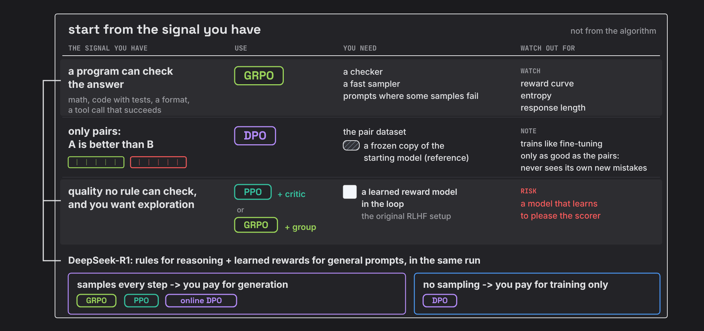

## Cheat sheet

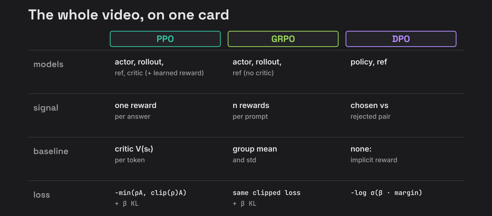

| | PPO | GRPO | DPO |
|---|---|---|---|
| Models | actor, rollout, reference, critic | actor, rollout, reference (optional) | policy, reference |
| Signal | one reward per answer | a group of n rewards per prompt | a chosen vs rejected pair |
| Baseline | the critic's value per token | the group's mean and std | none: an implicit reward |
| Loss | clipped ratio x advantage, + a KL leash | the same clipped loss | `-logsigmoid(beta * margin)` |

Underneath all three is one loop: generate, score, turn the scores into advantages, update, and sync the new weights back to the sampler. Eight answers, one number each, and a model a little better than it was a few seconds ago.

- [verl](https://github.com/verl-project/verl), pinned here at [`3fdf2b5488`](https://github.com/verl-project/verl/tree/3fdf2b5488): [`core_algos.py`](https://github.com/verl-project/verl/blob/3fdf2b5488/verl/trainer/ppo/core_algos.py) for the estimators and losses, the [GRPO](https://github.com/verl-project/verl/blob/3fdf2b5488/docs/algo/grpo.md) and [DAPO](https://github.com/verl-project/verl/blob/3fdf2b5488/docs/algo/dapo.md) docs; [verl-recipe](https://github.com/verl-project/verl-recipe) for the online DPO loss
- RLHF: [InstructGPT, arXiv 2203.02155](https://arxiv.org/abs/2203.02155); [PPO, arXiv 1707.06347](https://arxiv.org/abs/1707.06347); [GAE, arXiv 1506.02438](https://arxiv.org/abs/1506.02438)
- GRPO and R1: [DeepSeekMath, arXiv 2402.03300](https://arxiv.org/abs/2402.03300); [DeepSeek-R1, arXiv 2501.12948](https://arxiv.org/abs/2501.12948); [Dr. GRPO, arXiv 2503.20783](https://arxiv.org/abs/2503.20783)
- DPO: [Direct Preference Optimization, arXiv 2305.18290](https://arxiv.org/abs/2305.18290); [Zephyr, arXiv 2310.16944](https://arxiv.org/abs/2310.16944)
- The video: [The RL Primer You'll Finally Understand: RLHF, PPO, GRPO, DPO](https://youtu.be/VIDEO_ID_TBD)

The worked numbers in this post (0.375, 0.5175, +1.21 and -0.72, the ratios 1.16 and 1.30, the critic loss 0.18 and the logit gradient -0.37, the k3 value 0.18 and the GRPO gradient -1.40, the DPO margin 0.1, sigmoid 0.525 and loss 0.644, the reward 0.9995, the entropy values and the loss-aggregation weights) come from running the snippets above with PyTorch 2.15 on CPU. Their inputs (the probabilities 0.50, 0.58, 0.65 and 0.30, the critic values, the DPO log-probs) are illustrative, chosen to match the video. The verl excerpts are from verl at commit `3fdf2b5488`; the online DPO loss is from verl-recipe's `spin/core_algos.py`, which last changed in commit `21892b92`.

_The opinions expressed here are solely my own and do not express the views or opinions of my employer._

<!-- The front-matter image is kept for the home-page card and link previews; hide it on the post page, where the video sits at the top. -->
<style>
  article header .preview-img, article header .preview-img + figcaption { display: none; }
</style>
